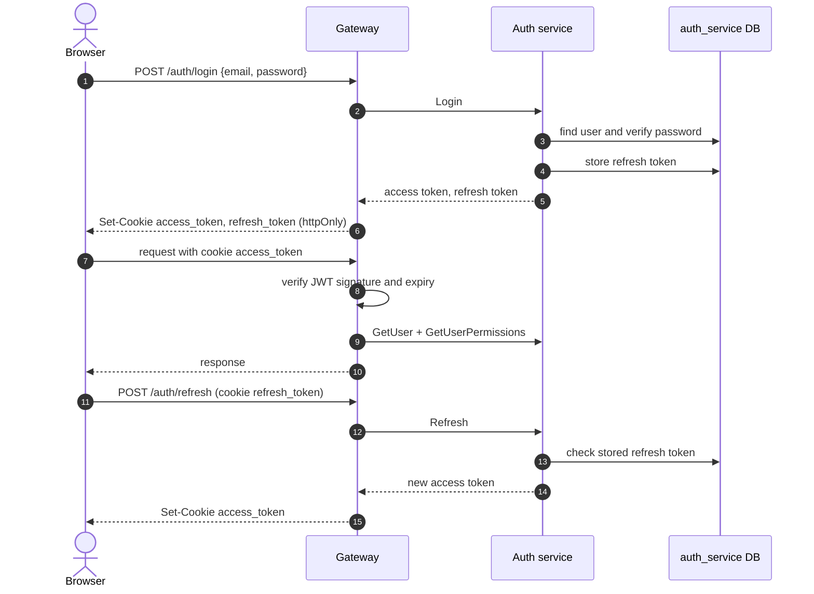

# Auth Service

Owns user accounts, platform roles, permissions and authentication tokens. It issues the JWTs used by the platform and tells the gateway and other services who a user is and which permissions they have.

- **Transport**: gRPC (`AuthService`). The contract is `libs/common/src/protos/auth.proto`.
- **Database**: PostgreSQL database `auth_service`, managed with Prisma. See [schema.md](./schema.md).
- **HTTP**: none. Public endpoints live in the gateway (`/auth/*`, `/users/*`); see Swagger at `/api/docs`.

## Boundaries

| Auth service does | Auth service does not |
| --- | --- |
| Store users, platform role assignments, roles and permissions | Decide whether a caller may invoke an RPC: authorization is enforced in the gateway |
| Hash passwords and issue access and refresh JWTs | Talk to Azure Entra ID: the gateway runs the OAuth flow and passes the Microsoft token to this service |
| Issue and validate one-time tokens (account setup, password reset) | Send email itself: it calls `notification-service` |
| Return a user's platform roles and permissions | Manage event-level membership: that belongs to `event-service` |

## Modules

Each module follows the layering described in `LLM_RULES.md` (`domain`, `application`, `infrastructure`, `interface`).

| Module | Responsibility |
| --- | --- |
| `auth` | Login, signup, session refresh, password reset and change, one-time tokens, Microsoft login |
| `users` | User creation, activation, updates and deactivation |
| `roles` | Role catalog and platform role assignments |
| `permissions` | Effective permissions of a user |

## Dependencies

- **Uses**: PostgreSQL and `notification-service` (emails).
- **Used by**: `gateway`, `invitation-service`, `event-service` and `evaluation-service`.

## Session mechanism

- The token only identifies the user. Roles and permissions are not inside it: the gateway asks this service for them on each request.
- Access and refresh tokens are signed with separate RSA key pairs. Only this service holds the private keys; the gateway only has the public keys.

## Related

- [schema.md](./schema.md): database schema and ER diagram.
- `libs/common/src/protos/auth.proto`: gRPC contract.
- `apps/gateway/src/modules/auth`: HTTP endpoints and JWT strategies.
