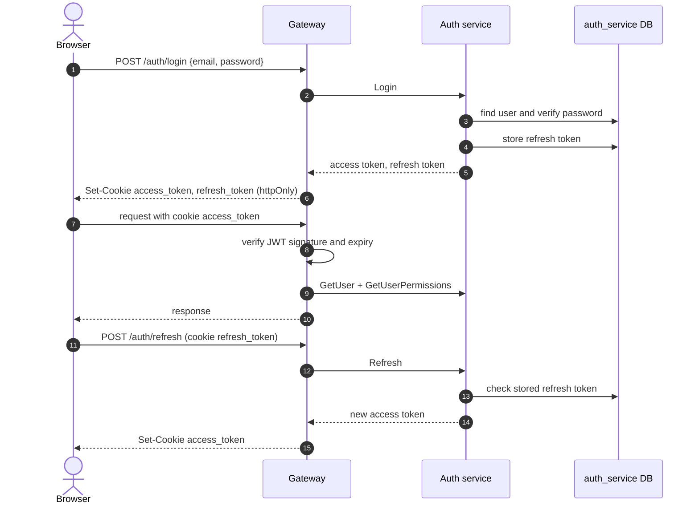

# Auth Service

Owns user accounts, platform roles, permissions and authentication tokens. It issues the JWTs used by the platform and tells the gateway and other services who a user is and which permissions they have.

- **Transport**: gRPC (`AuthService`). The contract is `libs/common/src/protos/auth.proto`.
- **Database**: PostgreSQL database `auth_service`, managed with Prisma. See [schema.md](./schema.md).
- **HTTP**: none. Public endpoints live in the gateway (`/auth/*`, `/users/*`); see Swagger at `/api/docs`.

## Boundaries

| Auth service does | Auth service does not |
| --- | --- |
| Store users, platform role assignments, roles and permissions | Decide whether a caller may invoke an RPC: permissions are checked in the gateway |
| Enforce the administrator rules when creating, editing, deactivating users or changing their roles (see below) | Scope what academic profiles see (course, department, tutored projects): planned for the endpoints of those profiles |
| Hash passwords and issue access and refresh JWTs | Talk to Azure Entra ID: the gateway runs the OAuth flow and passes the Microsoft token to this service |
| Issue and validate one-time tokens (account setup, password reset) | Send email itself: it calls `notification-service` |
| Return a user's platform roles and permissions | Manage event-level membership: that belongs to `event-service` |

## Modules

Each module follows the layering described in `LLM_RULES.md` (`domain`, `application`, `infrastructure`, `interface`).

| Module | Responsibility |
| --- | --- |
| `auth` | Login, signup, session refresh, password reset and change, one-time tokens, Microsoft login |
| `users` | User creation, activation, updates and deactivation |
| `roles` | Role catalog and platform role assignments |
| `permissions` | Effective permissions of a user |

## Roles and permissions

The role and permission catalogue lives in the migrations of this service, not in the seed: the seed only creates the initial users when the database has none. Role ids are fixed because other services use them (`User` = 3 at signup, `Juror` = 4 in `project-service`).

| Id | Role | Scope | Who | Access |
| --- | --- | --- | --- | --- |
| 1 | `Admin` | PLATFORM | Principal administrator (technical team) | Everything; the gateway lets it through every permission check |
| 2 | `EventManager` | PLATFORM | Event manager (kept for existing accounts) | Manages events, invitations, courses and event members; reads users and grades |
| 3 | `User` | PLATFORM | Student and anyone who signs up | Own profile and public events |
| 4 | `Juror` | EVENT | Juror of an event (through event membership) | Evaluates assigned projects |
| 5 | `Participant` | EVENT | Participant of an event (through event membership) | Submits and edits their project |
| 6 | `FacultyAdmin` | PLATFORM | Faculty (decanatura) administrator | Every administrative operation except managing administrators (`manage:admins`) |
| 7 | `Dean` | PLATFORM | Dean | Read-only access to everything, including grades before they are published (`read:events`, `read:grades`, `read:users`, `read:invitations`) |
| 8 | `DepartmentDirector` | PLATFORM | Department director | Same as `User` until the endpoints scoped to their department exist |
| 9 | `Professor` | PLATFORM | Professor of a final project course | Same as `User` until the endpoints scoped to their course exist |
| 10 | `Tutor` | PLATFORM | Project tutor | Same as `User` until the endpoints scoped to their tutored projects exist |

- `read:events` lets a role read events, rubrics and configuration; `read:grades` adds grades, rankings and tie-breaks. Writing requires `manage:events`.
- Event roles are granted through event membership. `CreatePlatformUser` and `SetUserPlatformRoles` reject them as platform roles.
- `IsPlatformStaff` (every event in "my events") is true for `Admin` and for any role with `read:events`.

### Administrator rules

`CreatePlatformUser`, `UpdateUser`, `DeactivateUser` and `SetUserPlatformRoles` receive the user performing the operation (`actorUserId`; optional only in `UpdateUser`, which `invitation-service` calls when an invitation is accepted) and apply these rules, so they hold even when the endpoints are called directly:

- Only an actor with `manage:admins` (the principal `Admin`) grants or removes `Admin` and `FacultyAdmin`, or creates, edits or deactivates an account that holds one of them. A faculty administrator gets `PERMISSION_DENIED`.
- Nobody changes their own roles or deactivates their own account.
- The platform always keeps an active `Admin`: deactivating the last one, or removing the role from them, returns `FAILED_PRECONDITION`. Admins whose account is deactivated do not count.

## Dependencies

- **Uses**: PostgreSQL and `notification-service` (emails).
- **Used by**: `gateway`, `invitation-service`, `event-service` and `evaluation-service`.

## Session mechanism

- The token only identifies the user. Roles and permissions are not inside it: the gateway asks this service for them on each request.
- Access and refresh tokens are signed with separate RSA key pairs. Only this service holds the private keys; the gateway only has the public keys.

## Related

- [schema.md](./schema.md): database schema and ER diagram.
- `libs/common/src/protos/auth.proto`: gRPC contract.
- `apps/gateway/src/modules/auth`: HTTP endpoints and JWT strategies.
