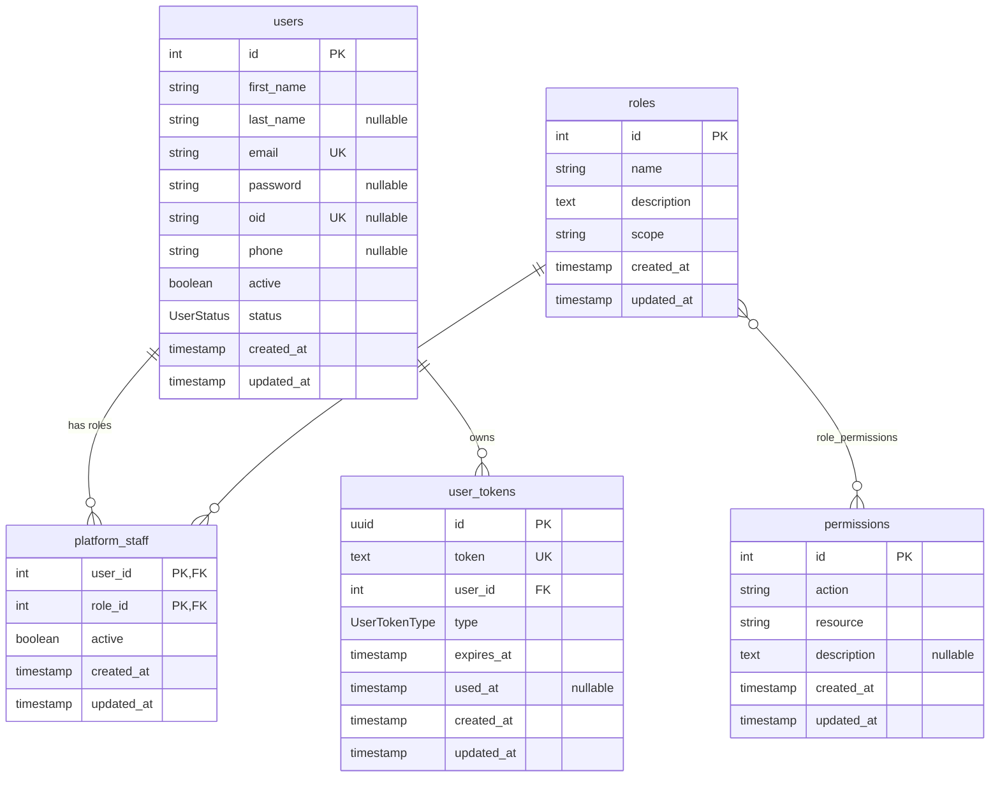

# Auth Service — Database Schema

Source of truth: `apps/auth-service/prisma/schema.prisma` (PostgreSQL, one database per service). Physical names use `snake_case` via `@map`/`@@map`; the application layer uses `camelCase`. The two migrations (`add_permissions_and_roles`, `adding_oid_to_users`) were checked against the schema and match it.

## ER diagram

Columns follow the order of `schema.prisma`. `PK`, `FK` and `UK` mark constraints; `"nullable"` marks optional columns.

`permissions` has a composite unique constraint `action_resource` on (`action`, `resource`). The `roles` ↔ `permissions` relation is an implicit Prisma many-to-many; see [`_role_permissions`](#_role_permissions-implicit-join-table).

## Enums

| Enum | Values | Meaning |
| --- | --- | --- |
| `UserStatus` | `PENDING`, `CONFIRMED` | `PENDING`: account created but not confirmed yet. `CONFIRMED`: account usable. Default `PENDING`. |
| `UserTokenType` | `RESET_PASSWORD`, `ACCOUNT_SETUP`, `REFRESH_TOKEN` | Purpose of a row in `user_tokens`. |

## Tables

### `users` (`User`)

| Column | Type | Null | Default / constraint |
| --- | --- | --- | --- |
| `id` | `SERIAL` | no | PK |
| `first_name` | `VARCHAR(100)` | no | |
| `last_name` | `VARCHAR(100)` | yes | |
| `email` | `VARCHAR(255)` | no | unique |
| `password` | `VARCHAR(255)` | yes | hashed; null for Microsoft-only accounts |
| `oid` | `VARCHAR(255)` | yes | unique; Azure Entra ID object id |
| `phone` | `VARCHAR(10)` | yes | |
| `active` | `BOOLEAN` | no | `true` |
| `status` | `UserStatus` | no | `PENDING` |
| `created_at` | `TIMESTAMP` | no | `now()` |
| `updated_at` | `TIMESTAMP` | no | maintained by Prisma (`@updatedAt`) |

Relations: 1:N `platform_staff`, 1:N `user_tokens`.

### `platform_staff` (`PlatformStaff`)

Assignment of a role to a user. Primary key is composite (`user_id`, `role_id`), so a role can be assigned to a user only once. Removing a role is a soft delete (`active = false`), not a row delete.

| Column | Type | Null | Default / constraint |
| --- | --- | --- | --- |
| `user_id` | `INTEGER` | no | PK, FK → `users.id` |
| `role_id` | `INTEGER` | no | PK, FK → `roles.id` |
| `active` | `BOOLEAN` | no | no default |
| `created_at` | `TIMESTAMP` | no | `now()` |
| `updated_at` | `TIMESTAMP` | no | `@updatedAt` |

### `user_tokens` (`UserToken`)

One table for all token kinds: one-time tokens (`ACCOUNT_SETUP`, `RESET_PASSWORD`) and refresh tokens (`REFRESH_TOKEN`). `used_at` is set when a one-time token is consumed, and also when a refresh token is invalidated.

| Column | Type | Null | Default / constraint |
| --- | --- | --- | --- |
| `id` | `UUID` | no | PK, generated |
| `token` | `TEXT` | no | unique |
| `user_id` | `INTEGER` | no | FK → `users.id` |
| `type` | `UserTokenType` | no | |
| `expires_at` | `TIMESTAMP` | no | |
| `used_at` | `TIMESTAMP` | yes | |
| `created_at` | `TIMESTAMP` | no | `now()` |
| `updated_at` | `TIMESTAMP` | no | `@updatedAt` |

### `roles` (`Role`)

| Column | Type | Null | Default / constraint |
| --- | --- | --- | --- |
| `id` | `SERIAL` | no | PK |
| `name` | `VARCHAR(50)` | no | not unique |
| `description` | `TEXT` | no | |
| `scope` | `VARCHAR(20)` | no | free text; the seed uses `PLATFORM` and `EVENT` |
| `created_at` | `TIMESTAMP` | no | `now()` |
| `updated_at` | `TIMESTAMP` | no | `@updatedAt` |

### `permissions` (`Permission`)

| Column | Type | Null | Default / constraint |
| --- | --- | --- | --- |
| `id` | `SERIAL` | no | PK |
| `action` | `VARCHAR(255)` | no | |
| `resource` | `VARCHAR(100)` | no | |
| `description` | `TEXT` | yes | |
| `created_at` | `TIMESTAMP` | no | `now()` |
| `updated_at` | `TIMESTAMP` | no | `@updatedAt` |

Unique constraint `action_resource` on (`action`, `resource`). Permissions are exposed as `action:resource` strings (for example `create:users`).

### `_role_permissions` (implicit join table)

Generated by Prisma for the `role_permissions` relation. `A` → `permissions.id`, `B` → `roles.id`; primary key (`A`, `B`); index on `B`; both foreign keys `ON DELETE CASCADE`.

## Foreign keys

| FK | References | On delete |
| --- | --- | --- |
| `platform_staff.user_id` | `users.id` | `RESTRICT` |
| `platform_staff.role_id` | `roles.id` | `RESTRICT` |
| `user_tokens.user_id` | `users.id` | `RESTRICT` |
| `_role_permissions.A` | `permissions.id` | `CASCADE` |
| `_role_permissions.B` | `roles.id` | `CASCADE` |

All foreign keys use `ON UPDATE CASCADE`.

## Notes

- `password` and `oid` are both optional. Local accounts have a password; Microsoft accounts have `oid` and no password.
- `users.active` and `users.status` are independent: `active` enables or disables the account, `status` records whether it was ever confirmed.
- `users.phone` has no unique constraint or index; uniqueness is only checked in application code. The column is `VARCHAR(10)`, so longer values (for example `+573001234567`) are rejected by the database.
- Authorization reads only `platform_staff` rows with `active = true`.
