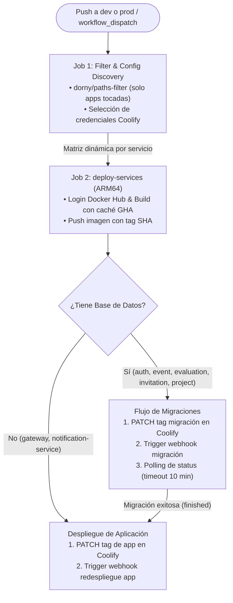

# Pipeline de CI/CD · IRIS Backend (Coolify + Docker Hub)

Este documento describe la arquitectura, configuración, secretos y procedimientos operativos del pipeline de Integración y Despliegue Continuo (CI/CD) del backend de **IRIS V3**.

El workflow principal está definido en [`.github/workflows/docker-push-workflow.yml`](../.github/workflows/docker-push-workflow.yml).

---

## 1. Arquitectura del Pipeline

El despliegue está automatizado con **GitHub Actions**, compilación nativa en arquitectura **ARM64**, almacenamiento de imágenes en **Docker Hub** y orquestación de contenedores mediante la API y webhooks de **Coolify**.



---

## 2. Eventos Disparadores y Concurrencia

### Triggers (`on:`)
* **`push` en `dev` y `prod`:** Se activa automáticamente cuando un Pull Request es aprobado y mergeado a las ramas base. **No** se ejecuta en PRs abiertos para evitar condiciones de carrera y despliegues de código no validado.
* **`workflow_dispatch`:** Permite despliegues manuales desde la consola de GitHub Actions, seleccionando la rama destino (`dev` o `prod`).

### Control de Concurrencia (`concurrency:`)
```yaml
concurrency:
  group: deploy-${{ github.ref_name || inputs.target_branch }}
  cancel-in-progress: false
```
Garantiza que si entran varios merges consecutivos sobre la misma rama, los despliegues se encolen ordenadamente y no se aborten migraciones en curso.

---

## 3. Detección de Cambios por Microservicio

El primer job (`detect-changes`) evalúa las rutas modificadas mediante `dorny/paths-filter@v4`. Si un commit solo modifica archivos dentro de `apps/auth-service/**`, la matriz de despliegue se ejecuta **únicamente** para `auth-service`, ignorando los 6 microservicios restantes.

### Clasificación de Servicios

| Microservicio | Ruta | Base de Datos (Prisma) | Ejecuta Migración previa |
| :--- | :--- | :---: | :---: |
| `auth-service` | `apps/auth-service/**` | ✅ PostgreSQL | ✅ Sí |
| `evaluation-service` | `apps/evaluation-service/**` | ✅ PostgreSQL | ✅ Sí |
| `event-service` | `apps/event-service/**` | ✅ PostgreSQL | ✅ Sí |
| `invitation-service` | `apps/invitation-service/**` | ✅ PostgreSQL | ✅ Sí |
| `project-service` | `apps/project-service/**` | ✅ PostgreSQL | ✅ Sí |
| `notification-service` | `apps/notification-service/**` | ❌ No | ❌ No |
| `gateway` | `apps/gateway/**` | ❌ No | ❌ No |

---

## 4. Secretos Requeridos en GitHub Actions

El repositorio de backend requiere los siguientes secretos configurados en **Settings ➔ Secrets and variables ➔ Actions**:

### 1. Docker Hub
* `DOCKERHUB_USERNAME`: Usuario u organización de Docker Hub.
* `DOCKERHUB_TOKEN`: Access Token con permisos de lectura y escritura.
* `DOCKERHUB_REPOSITORY`: Nombre del repositorio de imágenes.

### 2. `COOLIFY_URLS_TOKENS_JSON`
Mapea el endpoint de la API y el Bearer Token de Coolify por cada ambiente:

```json
{
  "dev": {
    "url": "coolify-dev.tudominio.com",
    "token": "coolify_api_token_para_dev"
  },
  "prod": {
    "url": "coolify-prod.tudominio.com",
    "token": "coolify_api_token_para_prod"
  }
}
```

### 3. `COOLIFY_WEBHOOKS_JSON`
Mapea los UUIDs de aplicaciones, migraciones y sus URLs de webhook por ambiente y microservicio:

```json
{
  "dev": {
    "auth-service": {
      "app_uuid": "coolify-uuid-app-dev",
      "webhook_app_url": "https://coolify-dev.tudominio.com/api/v1/deploy?uuid=...",
      "migration_uuid": "coolify-uuid-migration-dev",
      "webhook_migration_url": "https://coolify-dev.tudominio.com/api/v1/deploy?uuid=..."
    },
    "gateway": {
      "app_uuid": "coolify-uuid-gateway-dev",
      "webhook_app_url": "https://coolify-dev.tudominio.com/api/v1/deploy?uuid=..."
    }
  },
  "prod": {
    "auth-service": {
      "app_uuid": "coolify-uuid-app-prod",
      "webhook_app_url": "https://coolify-prod.tudominio.com/api/v1/deploy?uuid=...",
      "migration_uuid": "coolify-uuid-migration-prod",
      "webhook_migration_url": "https://coolify-prod.tudominio.com/api/v1/deploy?uuid=..."
    }
  }
}
```

> **Nota:** Para servicios sin base de datos (`gateway`, `notification-service`), las claves `migration_uuid` y `webhook_migration_url` se omiten o se dejan vacías.

---

## 5. 🛠️ Guía de Solución de Fallos (Troubleshooting)

### A. Fallo en llamadas `curl` a Coolify (`curl -f` arroja error de conexión)
* **Causa común:** El túnel de Cloudflare (`cloudflared`) del servidor local de desarrollo está inactivo o la máquina física está apagada.
* **Diagnóstico:** Revisa el step fallido en GitHub Actions. Si reporta `Could not resolve host` o timeout de conexión al dominio de Coolify en dev, se debe reiniciar el daemon de Cloudflare Tunnel en el servidor local.

### B. Timeout en el sondeo de migración (`Check redeployment status`)
* **Causa común:** La migración de Prisma se bloqueó esperando un lock en la base de datos o falló silenciosamente sin actualizar el estado a `finished`.
* **Protección integrada:** El step cuenta con `timeout-minutes: 10`. Si en 10 minutos la migración no finaliza, el runner cancela el job evitando bucles infinitos.
* **Solución:** Acceder al dashboard web de Coolify, inspeccionar los logs del contenedor de migración del servicio correspondiente y verificar el error SQL / Prisma.

### C. Redespliegue manual de emergencia
Si se necesita forzar el redespliegue de un microservicio sin hacer commit:
1. Ir a **Actions** en GitHub.
2. Seleccionar **Docker Image CI**.
3. Clic en **Run workflow**.
4. Elegir la rama objetivo (`dev` o `prod`).
