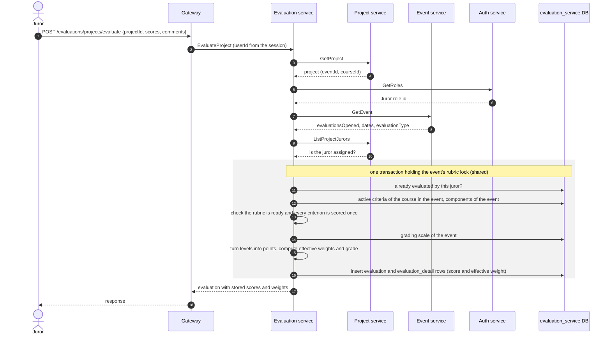

# Evaluation Service

Owns evaluation criteria, the components that group them, the grading scales of events, jurors' evaluations of projects and the manual tiebreak order used in rankings. It turns the levels a juror picks into points of the event's grading scale and a weighted grade and returns per-project averages so the platform can rank projects.

- **Transport**: gRPC (`EvaluationService`, `CriterionsService`, `TieBreakService`, `GradingScaleService`). The contract is `libs/common/src/protos/evaluation.proto`.
- **Database**: PostgreSQL database `evaluation_service`, managed with Prisma. See [schema.md](./schema.md).
- **HTTP**: none. Public endpoints live in the gateway (`/criterions/*`, `/evaluations/*`, `/tiebreaks/*`, `/grading-scales/*`); see Swagger at `/api/docs`.

## Boundaries

| Evaluation service does | Evaluation service does not |
| --- | --- |
| Store criteria, components, evaluations with their per-criterion scores, and tiebreaks | Store events, courses, projects or users: it keeps only their ids |
| Keep the catalog of grading scales, the scale of each event, and turn levels into points with it to compute the grade | Store the event itself: the scale is linked by `event_id` only |
| Reject an evaluation when evaluations are closed, the event is out of its dates, the juror is not assigned or already evaluated | Assign jurors to projects: that belongs to `project-service` |
| Return the average grade and evaluation count per project | Sort the ranking or apply tiebreaks: the gateway does it with the averages and the tiebreak rows |
| Check that a criterion's courses and component belong to its event, and refuse to grade with an incomplete rubric | Decide whether a caller may invoke an RPC: authorization is enforced in the gateway |
| Lock the rubric of a category once it is used to grade | Know a project's category: it asks `project-service` |

## Modules

Each module follows the layering described in `LLM_RULES.md` (`domain`, `application`, `infrastructure`, `interface`).

| Module | Responsibility |
| --- | --- |
| `criterions` | Criteria and their course associations; components (named, weighted groups of criteria) |
| `evaluations` | Evaluate a project, evaluation status per juror, project statistics, averages for rankings, dashboard count |
| `tiebreaks` | Manual order between tied projects of an event and category |
| `grading-scales` | Catalog of 4-level grading scales, the scale of each event, and the level ↔ points conversion |

## Grading scales

Every event has one **grading scale** with exactly 4 levels. For each criterion the juror picks a level from 1 to 4; the scale gives the points of that level, which is what is stored in `evaluation_detail.score` and used for the grade. Each level has a label (for example *Insuficiente*, *Aceptable*, *Bueno*, *Excelente*) and points with at most 2 decimals that grow strictly from level 1 to level 4.

The catalog starts with three read-only **system scales**, seeded by the migration. They have the points of the former evaluation types, so grades and rankings of existing events do not change:

| Scale | `code` | Points of levels 1, 2, 3, 4 |
| --- | --- | --- |
| Proyectos finales (default) | `FINAL_PROJECTS` | 25, 55, 75, 90 |
| Cero a cinco | `ZERO_TO_FIVE` | 2, 3, 4, 5 |
| Cero a cien | `ZERO_TO_HUNDRED` | 40, 60, 80, 100 |

In *Cero a cinco*, a stored `1.5` is still read back as level 1 (the value level 1 had before it was aligned with the poster rubric).

Rules:

- System scales are never edited or deleted.
- A catalog scale can be edited or deleted only while no event using it has evaluations; the error says which events block it and suggests creating a new scale. A scale assigned to an event cannot be deleted at all: assign the event another scale first.
- The scale of an event cannot change once the event has evaluations. Assigning the same scale again is accepted and changes nothing.
- These checks and the scale changes run under the exclusive rubric lock of the affected events, and an evaluation reads the scale under the shared lock (see [Changing a rubric in use](#changing-a-rubric-in-use)), so an evaluation never sees a scale halfway through a change.

`AssignEventGradingScale` takes a catalog scale (`scaleId`); a new scale is created first with `CreateGradingScale` (`POST /grading-scales`). Without `scaleId`, the event gets the system scale of its deprecated `evaluationType`, which `event-service` sets to `FINAL_PROJECTS` by default. Creating and editing an event in the gateway accept only `gradingScaleId`. The gateway assigns the scale when an event is created, and if that fails it deletes the event and returns the error; an edit assigns it only when it sends `gradingScaleId`. `GET /events/:id` and the create and edit responses include the event's `gradingScale`.

### Events created before the catalog

`evaluationType` is deprecated but still accepted. The events live in `event-service`'s database, so the migration cannot link them to a scale. Two mechanisms do it, both giving the system scale of the event's `evaluationType`:

- At startup, `GradingScaleBackfillService` pages through `ListEvents` of `event-service` in the background and inserts the missing `event_grading_scale` rows. It retries 5 times, 15 seconds apart, if `event-service` is not reachable. Set `GRADING_SCALE_BACKFILL=false` to turn it off.
- `EventGradingScaleResolver`, used by every reader of the scale, assigns and saves the same scale the first time an event without one is used.

An existing assignment is never overwritten by either of them.

## Rubric and grade

An event has one rubric for all its categories (courses). **Components** belong to the event and carry the fraction of the grade they are worth; they must add up to 1. **Criteria** belong to one component and one or more categories, with a `weight` relative to the other criteria of the same component and category (1 by default).

```txt
effectiveWeight = component.weight × criterion.weight ÷ Σ criterion.weight (same component, same category)
grade           = round2(Σ points of the chosen level × effectiveWeight)
```

Example: a `0.3` component with criteria weighted 10, 9 and 9 gives them `0.107`, `0.096` and `0.096`. Each score is saved with its effective weight (`evaluation_detail.weight`), so a saved grade never changes.

A category is **ready** when the components add up to 1 and each one has an active criterion in that category. Evaluations of a category that is not ready are rejected, and every criterion must be scored exactly once. `GET /criterions/readiness` shows what each category is missing.

A project's ranking value is the average of its grades, rounded with `roundGrade` (`libs/common/src/utils/grade-rounding.ts`), which the gateway also uses.

### Changing a rubric in use

All projects of a category are graded with the same rubric, so once grading starts only names and descriptions can change:

- **Criteria** lock per category as soon as a project of that category has evaluations. Other categories can still be completed.
- **Components** lock per event as soon as it has evaluations.

There is no exception for an incomplete rubric: fixing it would grade the remaining jurors with a different rubric than the ones who already evaluated, and historical grades are never recalculated. Evaluations of deleted projects are ignored when deciding which categories are locked.

Rubric changes and evaluations of an event never interleave: both run in a transaction holding a Postgres advisory lock on the event (shared for evaluations, exclusive for changes). If the lock cannot be taken in time the call fails with `ABORTED` and can be retried. Inside that transaction an evaluation also locks its (project, juror, event), so two simultaneous submissions of the same juror cannot both be saved. Repositories must query through `this.prisma.db`, which points to that transaction.

## Dependencies

- **Uses**: PostgreSQL, `project-service` (project, its jurors, and the category of each project of an event), `event-service` (event and its courses) and `auth-service` (role catalog, to find the `Juror` role id).
- **Used by**: `gateway`.

## Main flow: evaluating a project



- The evaluator is identified by (`member_user_id`, `member_event_id`, `member_role_id`), mirroring an event membership in `event-service`. The role is always the `Juror` role.
- Stored scores are the points of the chosen levels. When a juror's evaluation status is read, the service turns them back into levels 1–4 with the event's scale.

## Related

- [schema.md](./schema.md): database schema and ER diagram.
- `libs/common/src/protos/evaluation.proto`: gRPC contract.
- `apps/gateway/src/modules/criterions`, `evaluations`, `tiebreaks` and `grading-scales`: HTTP endpoints and ranking assembly.
