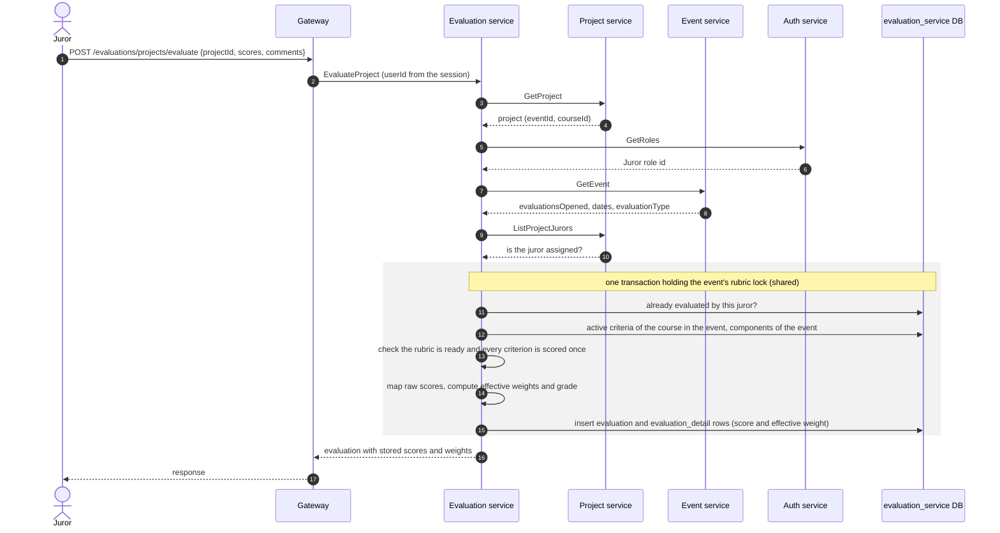

# Evaluation Service

Owns evaluation criteria, the components that group them, jurors' evaluations of projects and the manual tiebreak order used in rankings. It turns a juror's raw scores into a weighted grade and returns per-project averages so the platform can rank projects.

- **Transport**: gRPC (`EvaluationService`, `CriterionsService`, `TieBreakService`). The contract is `libs/common/src/protos/evaluation.proto`.
- **Database**: PostgreSQL database `evaluation_service`, managed with Prisma. See [schema.md](./schema.md).
- **HTTP**: none. Public endpoints live in the gateway (`/criterions/*`, `/evaluations/*`, `/tiebreaks/*`); see Swagger at `/api/docs`.

## Boundaries

| Evaluation service does | Evaluation service does not |
| --- | --- |
| Store criteria, components, evaluations with their per-criterion scores, and tiebreaks | Store events, courses, projects or users: it keeps only their ids |
| Validate and map raw scores according to the event's evaluation type, and compute the grade | Decide the evaluation type: `event-service` owns it per event |
| Reject an evaluation when evaluations are closed, the event is out of its dates, the juror is not assigned or already evaluated | Assign jurors to projects: that belongs to `project-service` |
| Return the average grade and evaluation count per project | Sort the ranking or apply tiebreaks: the gateway does it with the averages and the tiebreak rows |
| Check that a criterion's courses and component belong to its event, and refuse to grade with an incomplete rubric | Decide whether a caller may invoke an RPC: authorization is enforced in the gateway |
| Lock the rubric of a category once it is used to grade | Know a project's category: it asks `project-service` |

## Modules

Each module follows the layering described in `LLM_RULES.md` (`domain`, `application`, `infrastructure`, `interface`).

| Module | Responsibility |
| --- | --- |
| `criterions` | Criteria and their course associations; components (named, weighted groups of criteria) |
| `evaluations` | Evaluate a project, evaluation status per juror, project statistics, averages for rankings, dashboard count |
| `tiebreaks` | Manual order between tied projects of an event and category |

## Evaluation types

The event's `evaluationType` is never sent in the evaluation request. The service resolves it from `project.eventId → event.evaluationType` and picks a score validator and mapper for it. In every type the juror submits a raw score from 1 to 4 per criterion; only the stored value changes.

| Type | Raw score | Stored score |
| --- | --- | --- |
| `FINAL_PROJECTS` (default when the event has none) | 1, 2, 3, 4 | 25, 55, 75, 90 |
| `ZERO_TO_FIVE` | 1, 2, 3, 4 | 2, 3, 4, 5 |
| `ZERO_TO_HUNDRED` | 1, 2, 3, 4 | 40, 60, 80, 100 |

Raw scores must be integers. In `ZERO_TO_FIVE`, a stored `1.5` is also read back as raw score 1.

## Rubric and grade

An event has one rubric for all its categories (courses). **Components** belong to the event and carry the fraction of the grade they are worth; they must add up to 1. **Criteria** belong to one component and one or more categories, with a `weight` relative to the other criteria of the same component and category (1 by default).

```txt
effectiveWeight = component.weight × criterion.weight ÷ Σ criterion.weight (same component, same category)
grade           = round2(Σ storedScore × effectiveWeight)
```

Example: a `0.3` component with criteria weighted 10, 9 and 9 gives them `0.107`, `0.096` and `0.096`. Each score is saved with its effective weight (`evaluation_detail.weight`), so a saved grade never changes.

A category is **ready** when the components add up to 1 and each one has an active criterion in that category. Evaluations of a category that is not ready are rejected, and every criterion must be scored exactly once. `GET /criterions/readiness` shows what each category is missing.

A project's ranking value is the average of its grades, rounded with `roundGrade` (`libs/common/src/utils/grade-rounding.ts`), which the gateway also uses.

### Changing a rubric in use

All projects of a category are graded with the same rubric, so once grading starts only names and descriptions can change:

- **Criteria** lock per category as soon as a project of that category has evaluations. Other categories can still be completed.
- **Components** lock per event as soon as it has evaluations.

There is no exception for an incomplete rubric: fixing it would grade the remaining jurors with a different rubric than the ones who already evaluated, and historical grades are never recalculated. Evaluations of deleted projects are ignored when deciding which categories are locked.

Rubric changes and evaluations of an event never interleave: both run in a transaction holding a Postgres advisory lock on the event (shared for evaluations, exclusive for changes). If the lock cannot be taken in time the call fails with `ABORTED` and can be retried. Inside that transaction an evaluation also locks its (project, juror, event), so two simultaneous submissions of the same juror cannot both be saved. Repositories must query through `this.prisma.db`, which points to that transaction.

## Result for participants

`GetProjectResult` gives the consolidated result of one project, which the gateway shows to its participants once the admin publishes the event results:

- `finalScore`: average of the jurors' grades, rounded with `roundGrade` as in the ranking.
- `maxScore`: stored value of the highest raw score (4) in the event's evaluation type, which is also the highest grade.
- `criteria`: average stored score per criterion, with its component and the effective weight stored with the evaluations.
- `consolidatedFeedback`: the jurors' comments in one text, empty ones skipped.

It never returns juror ids nor how many jurors evaluated, and it does not check publication or who asks: the gateway does.

## Dependencies

- **Uses**: PostgreSQL, `project-service` (project, its jurors, and the category of each project of an event), `event-service` (event and its courses) and `auth-service` (role catalog, to find the `Juror` role id).
- **Used by**: `gateway`.

## Main flow: evaluating a project



- The evaluator is identified by (`member_user_id`, `member_event_id`, `member_role_id`), mirroring an event membership in `event-service`. The role is always the `Juror` role.
- Stored scores are the mapped values. When a juror's evaluation status is read, the service maps them back to the raw 1–4 values.

## Related

- [schema.md](./schema.md): database schema and ER diagram.
- `libs/common/src/protos/evaluation.proto`: gRPC contract.
- `apps/gateway/src/modules/criterions`, `evaluations` and `tiebreaks`: HTTP endpoints and ranking assembly.
