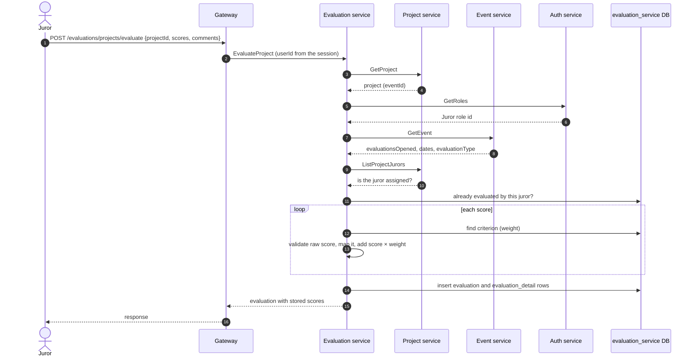

# Evaluation Service

Owns evaluation criteria, the components that group them, jurors' evaluations of projects and the manual tiebreak order used in rankings. It turns a juror's raw scores into a weighted grade and returns per-project averages so the platform can rank projects.

- **Transport**: gRPC (`EvaluationService`, `CriterionsService`, `TieBreakService`). The contract is `libs/common/src/protos/evaluation.proto`.
- **Database**: PostgreSQL database `evaluation_service`, managed with Prisma. See [schema.md](./schema.md).
- **HTTP**: none. Public endpoints live in the gateway (`/criterions/*`, `/evaluations/*`, `/tiebreaks/*`); see Swagger at `/api/docs`.

## Boundaries

| Evaluation service does | Evaluation service does not |
| --- | --- |
| Store criteria, components, evaluations with their per-criterion scores, and tiebreaks | Store events, courses, projects or users: it keeps only their ids |
| Validate and map raw scores according to the event's evaluation type, and compute the grade | Decide the evaluation type: `event-service` owns it per event |
| Reject an evaluation when evaluations are closed, the event is out of its dates, the juror is not assigned or already evaluated | Assign jurors to projects: that belongs to `project-service` |
| Return the average grade and evaluation count per project | Sort the ranking or apply tiebreaks: the gateway does it with the averages and the tiebreak rows |
| Check that a criterion's courses belong to its event and that active weights per course do not exceed 100% | Decide whether a caller may invoke an RPC: authorization is enforced in the gateway |

## Modules

Each module follows the layering described in `LLM_RULES.md` (`domain`, `application`, `infrastructure`, `interface`).

| Module | Responsibility |
| --- | --- |
| `criterions` | Criteria and their course associations; components (named, weighted groups of criteria) |
| `evaluations` | Evaluate a project, evaluation status per juror, project statistics, averages for rankings, dashboard count |
| `tiebreaks` | Manual order between tied projects of an event and category |

## Evaluation types

The event's `evaluationType` is never sent in the evaluation request. The service resolves it from `project.eventId → event.evaluationType` and picks a score validator and mapper for it. In every type the juror submits a raw score from 1 to 4 per criterion; only the stored value changes.

| Type | Raw score | Stored score |
| --- | --- | --- |
| `FINAL_PROJECTS` (default when the event has none) | 1, 2, 3, 4 | 25, 55, 75, 90 |
| `ZERO_TO_FIVE` | 1, 2, 3, 4 | 1.5, 3, 4, 5 |
| `ZERO_TO_HUNDRED` | 1, 2, 3, 4 | 40, 60, 80, 100 |

The grade of one evaluation is a weighted sum of the stored scores:

```txt
grade = Σ storedScore × criterion.weight
```

`criterion.weight` is a fraction (0 to 1) and the active criteria of a course add up to at most 1, so the grade stays on the scale of the stored scores. A project's ranking value is the average `grade` of all its evaluations. Component weights are only returned for display; they are not part of the calculation.

## Dependencies

- **Uses**: PostgreSQL, `project-service` (project and its jurors), `event-service` (event and its courses) and `auth-service` (role catalog, to find the `Juror` role id).
- **Used by**: `gateway`.

## Main flow: evaluating a project



- The evaluator is identified by (`member_user_id`, `member_event_id`, `member_role_id`), mirroring an event membership in `event-service`. The role is always the `Juror` role.
- Stored scores are the mapped values. When a juror's evaluation status is read, the service maps them back to the raw 1–4 values.

## Related

- [schema.md](./schema.md): database schema and ER diagram.
- `libs/common/src/protos/evaluation.proto`: gRPC contract.
- `apps/gateway/src/modules/criterions`, `evaluations` and `tiebreaks`: HTTP endpoints and ranking assembly.
