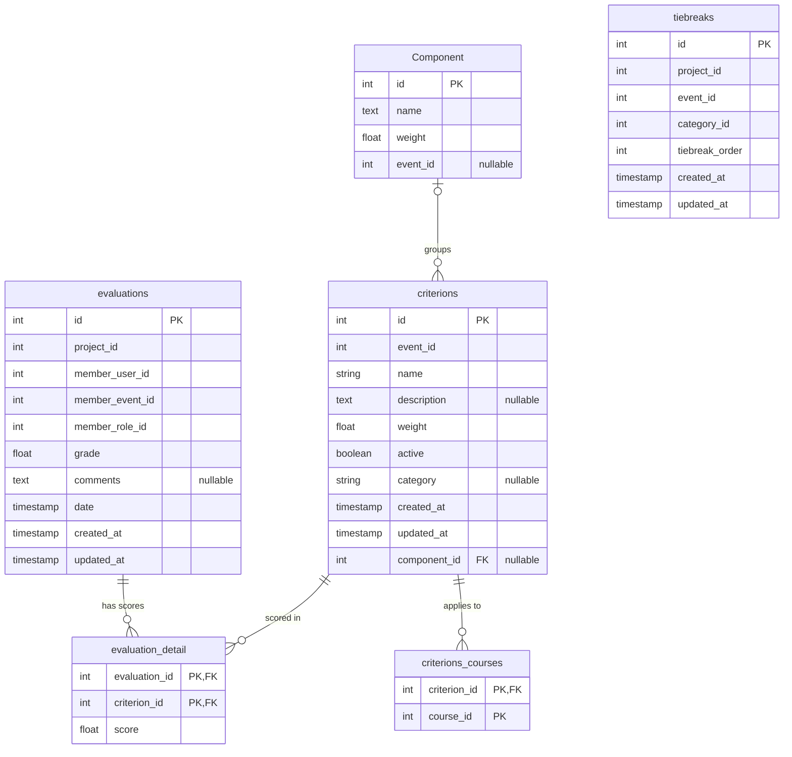

# Evaluation Service — Database Schema

Source of truth: `apps/evaluation-service/prisma/schema.prisma` (PostgreSQL, one database per service). Physical names use `snake_case` via `@map`/`@@map`, except the `Component` table, which has no `@@map` and keeps its PascalCase name. The application layer uses `camelCase`.

The five migrations (`init`, `added_category_field_for_criterions`, `add_components`, `add_event_id_to_component`, `add_tiebreak_table`) were applied in order to an empty PostgreSQL 16 database on 2026-11-02. The resulting tables, columns, types, nullability, defaults and foreign keys match this document and `schema.prisma`.

## ER diagram

Columns follow the order of `schema.prisma`. `PK`, `FK` and `UK` mark constraints; `"nullable"` marks optional columns. Columns ending in `_id` without `FK` hold ids owned by other services.

`tiebreaks` has no foreign keys to the other tables.

## Tables

### `evaluations` (`Evaluation`)

One juror's evaluation of one project.

| Column | Type | Null | Default / constraint |
| --- | --- | --- | --- |
| `id` | `SERIAL` | no | PK |
| `project_id` | `INTEGER` | no | project in `project-service` |
| `member_user_id` | `INTEGER` | no | evaluator's user id in `auth-service` |
| `member_event_id` | `INTEGER` | no | event of the evaluator's membership |
| `member_role_id` | `INTEGER` | no | evaluator's role id (the `Juror` role) |
| `grade` | `DOUBLE PRECISION` | no | weighted sum of the stored scores |
| `comments` | `TEXT` | yes | |
| `date` | `TIMESTAMP` | no | `CURRENT_TIMESTAMP` |
| `created_at` | `TIMESTAMP` | no | `CURRENT_TIMESTAMP` |
| `updated_at` | `TIMESTAMP` | no | maintained by Prisma (`@updatedAt`) |

Relations: 1:N `evaluation_detail`.

### `evaluation_detail` (`EvaluationDetail`)

Score of one criterion inside one evaluation. Primary key is composite (`evaluation_id`, `criterion_id`), so a criterion is scored at most once per evaluation. `score` is the stored (mapped) value, not the juror's raw 1–4 input; see the evaluation types in [README.md](./README.md#evaluation-types).

| Column | Type | Null | Default / constraint |
| --- | --- | --- | --- |
| `evaluation_id` | `INTEGER` | no | PK, FK → `evaluations.id` |
| `criterion_id` | `INTEGER` | no | PK, FK → `criterions.id` |
| `score` | `DOUBLE PRECISION` | no | |

### `criterions` (`Criterion`)

| Column | Type | Null | Default / constraint |
| --- | --- | --- | --- |
| `id` | `SERIAL` | no | PK |
| `event_id` | `INTEGER` | no | event in `event-service` |
| `name` | `VARCHAR(100)` | no | |
| `description` | `TEXT` | yes | |
| `weight` | `DOUBLE PRECISION` | no | fraction between 0 and 1, checked in application code |
| `active` | `BOOLEAN` | no | no default |
| `category` | `VARCHAR(100)` | yes | free-text grouping label |
| `created_at` | `TIMESTAMP` | no | `CURRENT_TIMESTAMP` |
| `updated_at` | `TIMESTAMP` | no | `@updatedAt` |
| `component_id` | `INTEGER` | yes | FK → `Component.id` |

In the database, `category` and `component_id` are the last two columns because they were added by later migrations.

### `criterions_courses` (`CriterionCourse`)

Association between a criterion and the courses (categories of an event in `event-service`) it applies to. Primary key is composite (`criterion_id`, `course_id`).

| Column | Type | Null | Default / constraint |
| --- | --- | --- | --- |
| `criterion_id` | `INTEGER` | no | PK, FK → `criterions.id` |
| `course_id` | `INTEGER` | no | PK; course in `event-service` |

### `Component` (`Component`)

Named, weighted group of criteria. It has no timestamps.

| Column | Type | Null | Default / constraint |
| --- | --- | --- | --- |
| `id` | `SERIAL` | no | PK |
| `name` | `TEXT` | no | |
| `weight` | `DOUBLE PRECISION` | no | fraction between 0 and 1, checked in application code |
| `event_id` | `INTEGER` | yes | event in `event-service` |

### `tiebreaks` (`TieBreak`)

Manual position of a project among tied projects of an event and category. Lower `tiebreak_order` ranks higher.

| Column | Type | Null | Default / constraint |
| --- | --- | --- | --- |
| `id` | `SERIAL` | no | PK |
| `project_id` | `INTEGER` | no | project in `project-service` |
| `event_id` | `INTEGER` | no | event in `event-service` |
| `category_id` | `INTEGER` | no | course or category in `event-service` |
| `tiebreak_order` | `INTEGER` | no | check `tiebreaks_tiebreak_order_positive` (`> 0`) |
| `created_at` | `TIMESTAMP` | no | `CURRENT_TIMESTAMP` |
| `updated_at` | `TIMESTAMP` | no | `@updatedAt` |

## Foreign keys

| FK | References | On delete |
| --- | --- | --- |
| `evaluation_detail.evaluation_id` | `evaluations.id` | `RESTRICT` |
| `evaluation_detail.criterion_id` | `criterions.id` | `RESTRICT` |
| `criterions_courses.criterion_id` | `criterions.id` | `RESTRICT` |
| `criterions.component_id` | `Component.id` | `SET NULL` |

All foreign keys use `ON UPDATE CASCADE`.

## Notes

- The only indexes are the primary keys. There is no index on `evaluations.project_id` or on the evaluator columns, which are the usual filters.
- "One evaluation per juror and project" is checked in application code; the database has no unique constraint on (`project_id`, `member_user_id`, `member_event_id`).
- "One tiebreak per project, event and category" is also checked only in application code.
- The check constraint `tiebreaks_tiebreak_order_positive` exists only in the migration SQL; Prisma does not model check constraints, so it is not visible in `schema.prisma`.
- A criterion that already has scores cannot be deleted, because `evaluation_detail.criterion_id` is `ON DELETE RESTRICT`.
- `criterions.category` and `Component` both group criteria. Statistics per project group by `category`; the criteria form groups by component.
- All timestamps are `TIMESTAMP` without time zone.
