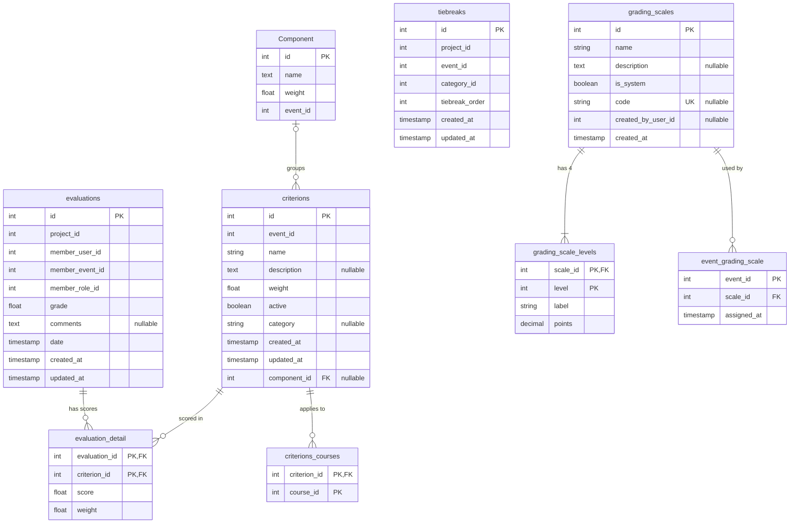

# Evaluation Service — Database Schema

Source of truth: `apps/evaluation-service/prisma/schema.prisma` (PostgreSQL, one database per service). Physical names use `snake_case` via `@map`/`@@map`, except the `Component` table, which has no `@@map` and keeps its PascalCase name. The application layer uses `camelCase`.

The first six migrations (`init`, `added_category_field_for_criterions`, `add_components`, `add_event_id_to_component`, `add_tiebreak_table`, `rubric_effective_weights_and_event_components`) were applied in order with `prisma migrate deploy` to an empty PostgreSQL 16 database on 2026-11-10, and `prisma migrate diff` against `schema.prisma` found no drift. The resulting tables, columns, types, nullability, defaults and foreign keys match this document. The data steps of `rubric_effective_weights_and_event_components` were checked on a database with sample data (shared and misassigned components, components without event, criteria without component, the 0.979 rubric of the report).

`add_grading_scales` creates `grading_scales`, `grading_scale_levels` and `event_grading_scale`, and seeds the three system scales with ids 1 to 3. On 2026-11-12 the seven migrations were applied with `prisma migrate deploy` to an empty PostgreSQL 16 database and `prisma migrate diff` against `schema.prisma` found no drift. Existing events get their row in `event_grading_scale` from the service, not from the migration (see [Events created before the catalog](./README.md#events-created-before-the-catalog)).

## ER diagram

Columns follow the order of `schema.prisma`. `PK`, `FK` and `UK` mark constraints; `"nullable"` marks optional columns. Columns ending in `_id` without `FK` hold ids owned by other services.

`tiebreaks` has no foreign keys to the other tables.

## Tables

### `evaluations` (`Evaluation`)

One juror's evaluation of one project.

| Column | Type | Null | Default / constraint |
| --- | --- | --- | --- |
| `id` | `SERIAL` | no | PK |
| `project_id` | `INTEGER` | no | project in `project-service` |
| `member_user_id` | `INTEGER` | no | evaluator's user id in `auth-service` |
| `member_event_id` | `INTEGER` | no | event of the evaluator's membership |
| `member_role_id` | `INTEGER` | no | evaluator's role id (the `Juror` role) |
| `grade` | `DOUBLE PRECISION` | no | weighted sum of the stored scores, rounded to 2 decimals |
| `comments` | `TEXT` | yes | |
| `date` | `TIMESTAMP` | no | `CURRENT_TIMESTAMP` |
| `created_at` | `TIMESTAMP` | no | `CURRENT_TIMESTAMP` |
| `updated_at` | `TIMESTAMP` | no | maintained by Prisma (`@updatedAt`) |

Relations: 1:N `evaluation_detail`.

### `evaluation_detail` (`EvaluationDetail`)

Score of one criterion inside one evaluation. Primary key is composite (`evaluation_id`, `criterion_id`), so a criterion is scored at most once per evaluation. `score` is the points of the level the juror picked in the event's grading scale, not the level itself; see [Grading scales](./README.md#grading-scales). `weight` is the effective weight the criterion had when it was scored ([Rubric and grade](./README.md#rubric-and-grade)); it is never recalculated.

| Column | Type | Null | Default / constraint |
| --- | --- | --- | --- |
| `evaluation_id` | `INTEGER` | no | PK, FK → `evaluations.id` |
| `criterion_id` | `INTEGER` | no | PK, FK → `criterions.id` |
| `score` | `DOUBLE PRECISION` | no | |
| `weight` | `DOUBLE PRECISION` | no | effective weight, between 0 and 1 |

### `criterions` (`Criterion`)

| Column | Type | Null | Default / constraint |
| --- | --- | --- | --- |
| `id` | `SERIAL` | no | PK |
| `event_id` | `INTEGER` | no | event in `event-service` |
| `name` | `VARCHAR(100)` | no | |
| `description` | `TEXT` | yes | |
| `weight` | `DOUBLE PRECISION` | no | relative weight inside its component and category, greater than 0 (1 when not sent), checked in application code |
| `active` | `BOOLEAN` | no | no default |
| `category` | `VARCHAR(100)` | yes | free-text grouping label |
| `created_at` | `TIMESTAMP` | no | `CURRENT_TIMESTAMP` |
| `updated_at` | `TIMESTAMP` | no | `@updatedAt` |
| `component_id` | `INTEGER` | yes | FK → `Component.id`; required by the application for active criteria |

In the database, `category` and `component_id` are the last two columns because they were added by later migrations.

### `criterions_courses` (`CriterionCourse`)

Association between a criterion and the courses (categories of an event in `event-service`) it applies to. Primary key is composite (`criterion_id`, `course_id`).

| Column | Type | Null | Default / constraint |
| --- | --- | --- | --- |
| `criterion_id` | `INTEGER` | no | PK, FK → `criterions.id` |
| `course_id` | `INTEGER` | no | PK; course in `event-service` |

### `Component` (`Component`)

Named, weighted group of criteria of one event. The weights of an event's components add up to 1 before the event can be evaluated. It has no timestamps.

| Column | Type | Null | Default / constraint |
| --- | --- | --- | --- |
| `id` | `SERIAL` | no | PK |
| `name` | `TEXT` | no | |
| `weight` | `DOUBLE PRECISION` | no | fraction of the grade, greater than 0 and at most 1, checked in application code |
| `event_id` | `INTEGER` | no | event in `event-service`; never changes |

### `tiebreaks` (`TieBreak`)

Manual position of a project among tied projects of an event and category. Lower `tiebreak_order` ranks higher.

| Column | Type | Null | Default / constraint |
| --- | --- | --- | --- |
| `id` | `SERIAL` | no | PK |
| `project_id` | `INTEGER` | no | project in `project-service` |
| `event_id` | `INTEGER` | no | event in `event-service` |
| `category_id` | `INTEGER` | no | course or category in `event-service` |
| `tiebreak_order` | `INTEGER` | no | check `tiebreaks_tiebreak_order_positive` (`> 0`) |
| `created_at` | `TIMESTAMP` | no | `CURRENT_TIMESTAMP` |
| `updated_at` | `TIMESTAMP` | no | `@updatedAt` |

### `grading_scales` (`GradingScale`)

Catalog of grading scales. System scales (`is_system`) are seeded by the migration and never change; the others are created through the gateway.

| Column | Type | Null | Default / constraint |
| --- | --- | --- | --- |
| `id` | `SERIAL` | no | PK; 1 to 3 are the system scales |
| `name` | `VARCHAR(100)` | no | |
| `description` | `TEXT` | yes | |
| `is_system` | `BOOLEAN` | no | `false` |
| `code` | `VARCHAR(32)` | yes | unique; `FINAL_PROJECTS`, `ZERO_TO_FIVE` or `ZERO_TO_HUNDRED` for the system scales, null for the others |
| `created_by_user_id` | `INTEGER` | yes | user in `auth-service`; null for the system scales |
| `created_at` | `TIMESTAMP` | no | `CURRENT_TIMESTAMP` |

Seeded rows:

| `id` | `name` | `code` | Points of levels 1–4 |
| --- | --- | --- | --- |
| 1 | Proyectos finales | `FINAL_PROJECTS` | 25, 55, 75, 90 |
| 2 | Cero a cinco | `ZERO_TO_FIVE` | 2, 3, 4, 5 |
| 3 | Cero a cien | `ZERO_TO_HUNDRED` | 40, 60, 80, 100 |

All three use the labels Insuficiente, Aceptable, Bueno and Excelente.

### `grading_scale_levels` (`GradingScaleLevel`)

The 4 levels of a scale. Primary key is composite (`scale_id`, `level`).

| Column | Type | Null | Default / constraint |
| --- | --- | --- | --- |
| `scale_id` | `INTEGER` | no | PK, FK → `grading_scales.id` |
| `level` | `INTEGER` | no | PK; check `grading_scale_levels_level_range` (1 to 4) |
| `label` | `VARCHAR(50)` | no | |
| `points` | `DECIMAL(7,2)` | no | check `grading_scale_levels_points_non_negative` (`>= 0`); unique per scale |

"Exactly 4 levels" and "points grow from level 1 to level 4" are checked in application code.

### `event_grading_scale` (`EventGradingScale`)

Scale of each event. One row per event.

| Column | Type | Null | Default / constraint |
| --- | --- | --- | --- |
| `event_id` | `INTEGER` | no | PK; event in `event-service` |
| `scale_id` | `INTEGER` | no | FK → `grading_scales.id`; indexed |
| `assigned_at` | `TIMESTAMP` | no | `CURRENT_TIMESTAMP`; updated when the scale changes |

## Foreign keys

| FK | References | On delete |
| --- | --- | --- |
| `evaluation_detail.evaluation_id` | `evaluations.id` | `RESTRICT` |
| `evaluation_detail.criterion_id` | `criterions.id` | `RESTRICT` |
| `criterions_courses.criterion_id` | `criterions.id` | `RESTRICT` |
| `criterions.component_id` | `Component.id` | `SET NULL` |
| `grading_scale_levels.scale_id` | `grading_scales.id` | `CASCADE` |
| `event_grading_scale.scale_id` | `grading_scales.id` | `RESTRICT` |

All foreign keys use `ON UPDATE CASCADE`.

## Notes

- Besides the primary keys, the only indexes are the unique keys of `grading_scales.code` and (`grading_scale_levels.scale_id`, `points`), and the index on `event_grading_scale.scale_id`. There is no index on `evaluations.project_id` or on the evaluator columns, which are the usual filters.
- "One evaluation per juror and project" is checked in application code; the database has no unique constraint on (`project_id`, `member_user_id`, `member_event_id`).
- "One tiebreak per project, event and category" is also checked only in application code.
- The check constraints `tiebreaks_tiebreak_order_positive`, `grading_scale_levels_level_range` and `grading_scale_levels_points_non_negative` exist only in the migration SQL; Prisma does not model check constraints, so they are not visible in `schema.prisma`.
- A criterion that already has scores cannot be deleted, because `evaluation_detail.criterion_id` is `ON DELETE RESTRICT`.
- `criterions.category` and `Component` both group criteria. Statistics per project group by `category`; the criteria form groups by component.
- All timestamps are `TIMESTAMP` without time zone.
- A scale that grades evaluations cannot be edited or deleted, and an event's scale cannot change once it has evaluations. These rules are checked in application code; `event_grading_scale.scale_id` is `ON DELETE RESTRICT`, so a scale still assigned to an event cannot be deleted.
