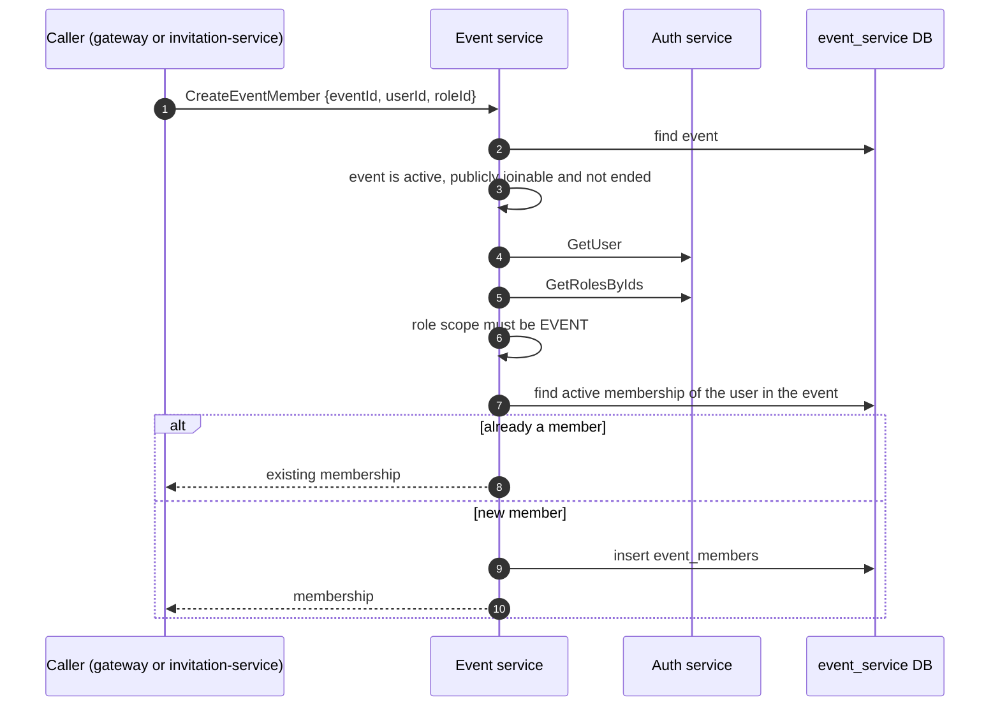

# Event Service

Owns events and everything attached to them: who takes part in an event and with which event role, categories (also exposed as "courses"), awards, inscription details, recaps and the ranking display configuration. It also derives the status of an event from its dates.

- **Transport**: gRPC (`EventService`, port `50053`). The contract is `libs/common/src/protos/event.proto`.
- **Database**: PostgreSQL database `event_service`, managed with Prisma. See [schema.md](./schema.md).
- **HTTP**: none. Public endpoints live in the gateway (`/events/*`); see Swagger at `/api/docs`.

## Boundaries

| Event service does | Event service does not |
| --- | --- |
| Store events, event members, categories, awards, award winners, inscription details, recaps and ranking configuration | Decide whether a caller may invoke an RPC: authorization is enforced in the gateway |
| Validate event dates and access code uniqueness | Own users or roles: it asks `auth-service` whether a user exists and which scope a role has |
| Compute the status of an event (`UPCOMING`, `REGISTRATION_CLOSED`, `AVAILABLE`, `CLOSED`) from its dates | Store projects or evaluations: those belong to `project-service` and `evaluation-service` |
| Store the `evaluation_type` configured for an event | Validate or map scores: `evaluation-service` reads the type from the event and applies the rules |

## Modules

Each module follows the layering described in `LLM_RULES.md` (`domain`, `application`, `infrastructure`, `interface`).

| Module | Responsibility |
| --- | --- |
| `events` | Event CRUD and listings, dashboard stats, AR listing, event members, ranking configuration, and the catalog (categories, awards, award winners, inscription details, recaps) |
| `courses` | Legacy "course" API. There is no courses table: it reads and writes `categories` (`code` maps to `name`) |

## Dependencies

- **Uses**: PostgreSQL and `auth-service` (`GetUser`, `GetRolesByIds`, `IsPlatformStaff`).
- **Used by**: `gateway`, `invitation-service`, `project-service` and `evaluation-service`.

## Adding a member to an event

- A user has at most one role per event: the primary key of `event_members` is (`user_id`, `event_id`).
- Removing a member is a soft delete (`active = false`); the row stays.

## Related

- [schema.md](./schema.md): database schema and ER diagram.
- `libs/common/src/protos/event.proto`: gRPC contract.
- `apps/gateway/src/modules/events`: HTTP endpoints.
