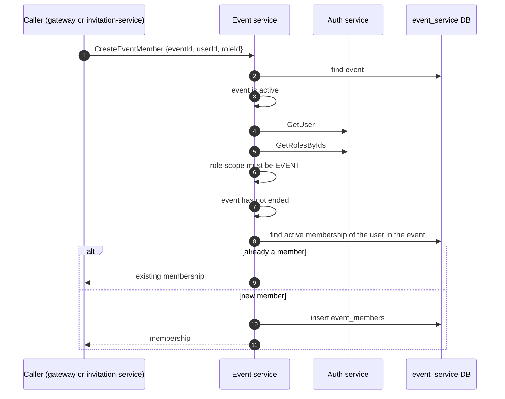

# Event Service

Owns events and everything attached to them: who takes part in an event and with which event role, categories (also exposed as "courses"), awards, inscription details, recaps and the ranking display configuration. It also derives the status of an event from its dates.

- **Transport**: gRPC (`EventService`, port `50053`). The contract is `libs/common/src/protos/event.proto`.
- **Database**: PostgreSQL database `event_service`, managed with Prisma. See [schema.md](./schema.md).
- **HTTP**: none. Public endpoints live in the gateway (`/events/*`); see Swagger at `/api/docs`.

## Boundaries

| Event service does | Event service does not |
| --- | --- |
| Store events, event members, categories, awards, award winners, inscription details, recaps and ranking configuration | Decide whether a caller may invoke an RPC: authorization is enforced in the gateway |
| Validate event dates and access code uniqueness | Own users or roles: it asks `auth-service` whether a user exists and which scope a role has |
| Compute the status of an event (`UPCOMING`, `REGISTRATION_CLOSED`, `AVAILABLE`, `CLOSED`) from its dates | Store projects or evaluations: those belong to `project-service` and `evaluation-service` |
| Store the `evaluation_type` configured for an event | Validate or map scores: `evaluation-service` reads the type from the event and applies the rules |

## Modules

Each module follows the layering described in `LLM_RULES.md` (`domain`, `application`, `infrastructure`, `interface`).

| Module | Responsibility |
| --- | --- |
| `events` | Event CRUD and listings, results publication (`results_published`: participants see their scores and awards only once the admin sets it), dashboard stats, AR listing, event members, ranking configuration, and the catalog (categories, awards, award winners, inscription details, recaps). For the student dashboard: `ListEventsByIds` (deleted events included, with `active = false`), `ListAwardsByProjects` (awards won by a set of projects in active categories, with their category, event and whether the event results are published) and `ListCategoriesByIds`. For the public winners page: `ListPublishedWinners` |
| `courses` | Legacy "course" API. There is no courses table: it reads and writes `categories` (`code` maps to `name`) |

## Dependencies

- **Uses**: PostgreSQL and `auth-service` (`GetUser`, `GetRolesByIds`, `IsPlatformStaff`).
- **Used by**: `gateway`, `invitation-service`, `project-service` and `evaluation-service`.

## Adding a member to an event

- A user has at most one role per event: the primary key of `event_members` is (`user_id`, `event_id`).
- Removing a member is a soft delete (`active = false`); the row stays.
- `is_publicly_joinable` does not apply here: accepting an invitation adds the member even to a private event. The flag only gates public project submissions (project-service `CreateProject`).

## Public winners across events

`ListPublishedWinners(page, limit)` is the permanent winners view across events (ClickUp 86e3wzr5x). It reads `award_winners` with their award, category and event, and applies the same rule as the gateway public ranking report:

- An event is included only when it is active, its ranking is public (`ranking_event.visible_public`) and it has at least one winner in an active category. Events without a ranking configuration are left out.
- Events are ordered by `end_date` descending, then `id` descending, and paginated by event (`limit` defaults to 10, at most 50).
- Each event lists its categories, each category its awards ordered by `position`, and each award its winners. Co-winners are several winners of the same award; `coWinners` is true when an award has more than one.
- `grade` is unset unless the event ranking shows grades (`ranking_event.grade_visible`).
- The response carries project ids only; the gateway adds the project names.

## Related

- [schema.md](./schema.md): database schema and ER diagram.
- `libs/common/src/protos/event.proto`: gRPC contract.
- `apps/gateway/src/modules/events`: HTTP endpoints.
