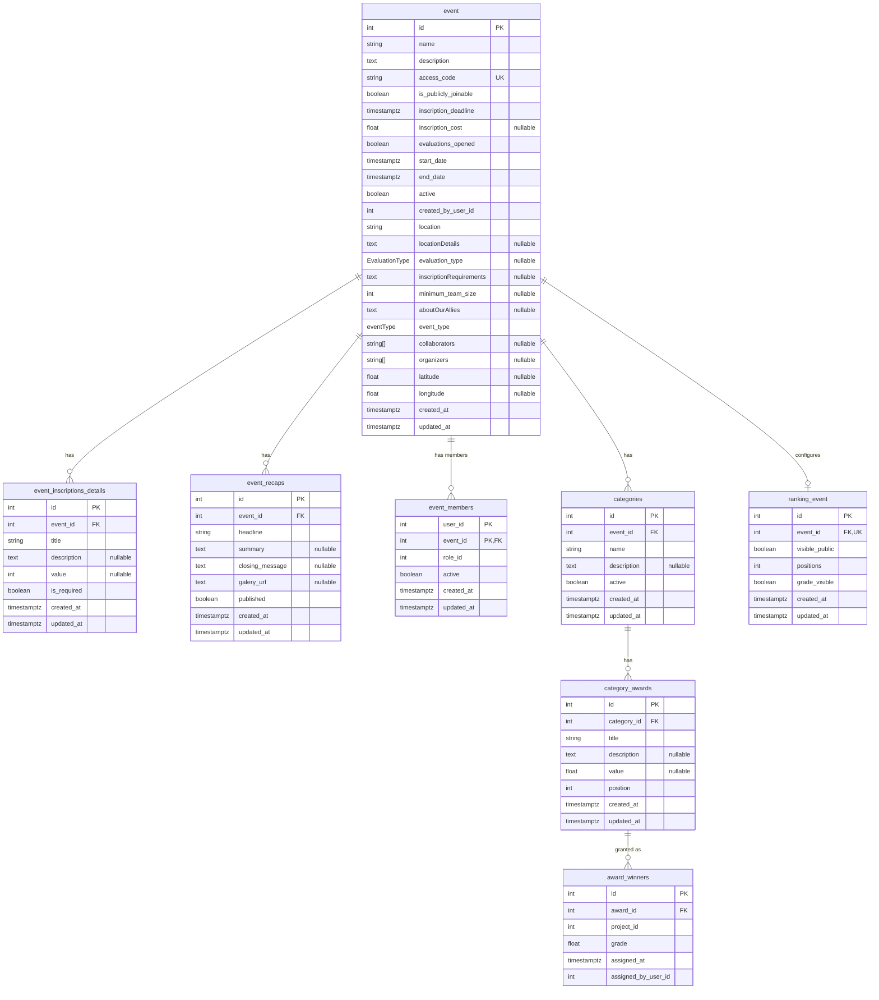

# Event Service — Database Schema

Source of truth: `apps/event-service/prisma/schema.prisma` (PostgreSQL, one database per service). Physical names use `snake_case` via `@map`/`@@map`, with three exceptions listed in the notes; the application layer uses `camelCase`. The migrations were checked against the schema and match it.

## ER diagram

Columns follow the order of `schema.prisma`. `PK`, `FK` and `UK` mark constraints; `"nullable"` marks optional columns.

`event.access_code` is unique. `ranking_event.event_id` is both a foreign key and unique, which makes the relation with `event` one-to-one.

## Enums

| Enum | Values | Meaning |
| --- | --- | --- |
| `eventType` | `Exposition`, `Competition` | Kind of event. The gRPC contract names them `EXPO` and `COMPETENCIA`. |
| `EvaluationType` | `FINAL_PROJECTS`, `ZERO_TO_FIVE`, `ZERO_TO_HUNDRED` | Evaluation scale configured for the event. `evaluation-service` reads it to validate and map scores. |

## Tables

### `event` (`Event`)

| Column | Type | Null | Default / constraint |
| --- | --- | --- | --- |
| `id` | `SERIAL` | no | PK |
| `name` | `VARCHAR(255)` | no | |
| `description` | `TEXT` | no | |
| `access_code` | `VARCHAR(100)` | no | unique |
| `is_publicly_joinable` | `BOOLEAN` | no | |
| `inscription_deadline` | `TIMESTAMPTZ` | no | |
| `inscription_cost` | `DOUBLE PRECISION` | yes | |
| `evaluations_opened` | `BOOLEAN` | no | |
| `start_date` | `TIMESTAMPTZ` | no | |
| `end_date` | `TIMESTAMPTZ` | no | |
| `active` | `BOOLEAN` | no | `true` |
| `created_by_user_id` | `INTEGER` | no | `auth-service.users.id`, no FK |
| `location` | `VARCHAR(255)` | no | |
| `locationDetails` | `TEXT` | yes | |
| `evaluation_type` | `EvaluationType` | yes | `FINAL_PROJECTS` |
| `inscriptionRequirements` | `TEXT` | yes | |
| `minimum_team_size` | `INTEGER` | yes | |
| `aboutOurAllies` | `TEXT` | yes | |
| `event_type` | `eventType` | no | |
| `collaborators` | `VARCHAR(255)[]` | yes | |
| `organizers` | `VARCHAR(255)[]` | yes | |
| `latitude` | `DOUBLE PRECISION` | yes | |
| `longitude` | `DOUBLE PRECISION` | yes | |
| `created_at` | `TIMESTAMPTZ` | no | `now()` |
| `updated_at` | `TIMESTAMPTZ` | no | maintained by Prisma (`@updatedAt`) |

Relations: 1:N `event_members`, `categories`, `event_inscriptions_details`, `event_recaps`; 1:1 `ranking_event`.

### `event_inscriptions_details` (`EventInscriptionDetail`)

Extra items shown during the inscription of an event.

| Column | Type | Null | Default / constraint |
| --- | --- | --- | --- |
| `id` | `SERIAL` | no | PK |
| `event_id` | `INTEGER` | no | FK → `event.id` |
| `title` | `VARCHAR(255)` | no | |
| `description` | `TEXT` | yes | |
| `value` | `INTEGER` | yes | `0` |
| `is_required` | `BOOLEAN` | no | `true` |
| `created_at` | `TIMESTAMPTZ` | no | `now()` |
| `updated_at` | `TIMESTAMPTZ` | no | `@updatedAt` |

### `event_recaps` (`EventRecap`)

Closing summary of an event.

| Column | Type | Null | Default / constraint |
| --- | --- | --- | --- |
| `id` | `SERIAL` | no | PK |
| `event_id` | `INTEGER` | no | FK → `event.id` |
| `headline` | `VARCHAR(255)` | no | |
| `summary` | `TEXT` | yes | |
| `closing_message` | `TEXT` | yes | |
| `galery_url` | `TEXT` | yes | |
| `published` | `BOOLEAN` | no | `false` |
| `created_at` | `TIMESTAMPTZ` | no | `now()` |
| `updated_at` | `TIMESTAMPTZ` | no | `@updatedAt` |

### `event_members` (`StaffEventMember`)

Membership of a user in an event, with the event role. Primary key is composite (`user_id`, `event_id`), so a user has one row, and therefore one role, per event. Removing a member is a soft delete (`active = false`), not a row delete.

| Column | Type | Null | Default / constraint |
| --- | --- | --- | --- |
| `user_id` | `INTEGER` | no | PK, `auth-service.users.id`, no FK |
| `event_id` | `INTEGER` | no | PK, FK → `event.id` |
| `role_id` | `INTEGER` | no | `auth-service.roles.id`, no FK |
| `active` | `BOOLEAN` | no | no default |
| `created_at` | `TIMESTAMPTZ` | no | `now()` |
| `updated_at` | `TIMESTAMPTZ` | no | `@updatedAt` |

### `categories` (`Category`)

Groups of an event. The "courses" API of this service reads and writes this same table.

| Column | Type | Null | Default / constraint |
| --- | --- | --- | --- |
| `id` | `SERIAL` | no | PK |
| `event_id` | `INTEGER` | no | FK → `event.id` |
| `name` | `VARCHAR(255)` | no | not unique |
| `description` | `TEXT` | yes | |
| `active` | `BOOLEAN` | no | `true` |
| `created_at` | `TIMESTAMPTZ` | no | `now()` |
| `updated_at` | `TIMESTAMPTZ` | no | `@updatedAt` |

### `category_awards` (`AwardCategoryEvent`)

Prize or placement defined for a category.

| Column | Type | Null | Default / constraint |
| --- | --- | --- | --- |
| `id` | `SERIAL` | no | PK |
| `category_id` | `INTEGER` | no | FK → `categories.id` |
| `title` | `VARCHAR(255)` | no | |
| `description` | `TEXT` | yes | |
| `value` | `DOUBLE PRECISION` | yes | |
| `position` | `INTEGER` | no | `0` |
| `created_at` | `TIMESTAMPTZ` | no | `now()` |
| `updated_at` | `TIMESTAMPTZ` | no | `@updatedAt` |

### `award_winners` (`AwardWinnerEvent`)

Project that won an award, with the grade that justified it.

| Column | Type | Null | Default / constraint |
| --- | --- | --- | --- |
| `id` | `SERIAL` | no | PK |
| `award_id` | `INTEGER` | no | FK → `category_awards.id` |
| `project_id` | `INTEGER` | no | `project-service.projects.id`, no FK |
| `grade` | `DOUBLE PRECISION` | no | |
| `assigned_at` | `TIMESTAMPTZ` | no | `now()` |
| `assigned_by_user_id` | `INTEGER` | no | `auth-service.users.id`, no FK |

### `ranking_event` (`RankingEvent`)

How the public ranking of an event is shown.

| Column | Type | Null | Default / constraint |
| --- | --- | --- | --- |
| `id` | `SERIAL` | no | PK |
| `event_id` | `INTEGER` | no | FK → `event.id`, unique |
| `visible_public` | `BOOLEAN` | no | `false` |
| `positions` | `INTEGER` | no | check `positions >= 0` |
| `grade_visible` | `BOOLEAN` | no | `false` |
| `created_at` | `TIMESTAMPTZ` | no | `now()` |
| `updated_at` | `TIMESTAMPTZ` | no | `@updatedAt` |

The `positions` check exists only in the SQL migration; Prisma cannot express it in `schema.prisma`.

## Foreign keys

| FK | References | On delete |
| --- | --- | --- |
| `event_inscriptions_details.event_id` | `event.id` | `RESTRICT` |
| `event_recaps.event_id` | `event.id` | `RESTRICT` |
| `event_members.event_id` | `event.id` | `RESTRICT` |
| `categories.event_id` | `event.id` | `RESTRICT` |
| `category_awards.category_id` | `categories.id` | `RESTRICT` |
| `award_winners.award_id` | `category_awards.id` | `RESTRICT` |
| `ranking_event.event_id` | `event.id` | `RESTRICT` |

All foreign keys use `ON UPDATE CASCADE`.

Columns that point to other services have no foreign key: `event.created_by_user_id`, `event_members.user_id`, `event_members.role_id`, `award_winners.project_id` and `award_winners.assigned_by_user_id`.

## Notes

- Three columns of `event` keep camelCase physical names because the schema has no `@map` for them: `locationDetails`, `inscriptionRequirements` and `aboutOurAllies`. The table is also named in the singular (`event`) while the rest are plural.
- `event.evaluation_type` is nullable and defaults to `FINAL_PROJECTS`. Rows created before the default existed may hold `NULL`; the service reads `NULL` as `FINAL_PROJECTS`.
- The status of an event is not stored. It is derived from `start_date`, `end_date` and `inscription_deadline`.
- Dates are stored in UTC. The service interprets incoming dates as Colombia time (UTC-5).
- Deleting an event is a soft delete (`event.active = false`). Categories are deleted for real, and the foreign key from `category_awards` blocks the delete while awards exist.
- Besides primary keys, the only indexes are the unique ones on `event.access_code` and `ranking_event.event_id`. Foreign key columns have no index.
- `inscription_cost`, `category_awards.value` and `award_winners.grade` are floating point, while `event_inscriptions_details.value` is an integer.
- `collaborators` and `organizers` are plain `VARCHAR(255)[]` arrays, not related tables.
- `collaborators` and `organizers` are nullable in the database: Prisma does not add `NOT NULL` to list columns. Prisma rejects an explicit `null`, stores `NULL` when the field is omitted, and returns `NULL` as an empty list.
