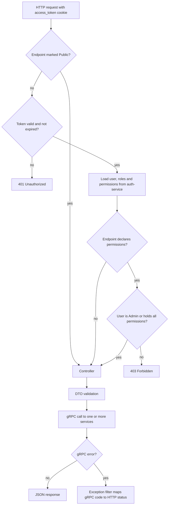

# Gateway

Single HTTP entry point of the platform. It authenticates the browser session, checks platform permissions, validates request bodies and turns each HTTP call into one or more gRPC calls to the backend services, combining their answers when a screen needs data from several of them.

- **Transport**: HTTP (NestJS + Express) towards the frontend; gRPC clients towards the services, generated from `libs/common/src/protos`.
- **Database**: none. It does not own domain data, so it has no `schema.md`.
- **API docs**: Swagger UI at `/api/docs`. Health check at `/health`.

## Boundaries

| Gateway does | Gateway does not |
| --- | --- |
| Read the session cookie, verify the access token and load the user with their platform roles and permissions | Issue or store tokens, users, roles or permissions: that belongs to `auth-service` |
| Enforce platform permissions declared on each endpoint | Decide event-level roles (juror, participant) or ownership: services do that; the gateway asks them first on `owner` endpoints (`CheckProjectAccess`, `AuthorizeInvitation`) |
| Run the Microsoft sign-in redirect and code exchange, then hand the Microsoft token to `auth-service` | Store project documents itself: files go to Azure Blob Storage |
| Validate request shape with DTOs and map gRPC errors to HTTP status codes | Persist anything: every state change happens in a service |
| Combine data from several services for some screens (rankings, top projects, juror lists, dashboard) | Send emails: services call `notification-service` |

## Modules

| Module | Responsibility | Services it calls |
| --- | --- | --- |
| `auth` | Login, Microsoft sign-in, signup, activation, refresh, logout, password flows, current user | `auth` |
| `users` | Platform user administration and platform roles | `auth` |
| `events` | Events, courses and categories, awards, inscription details, recaps, members, ranking configuration, rankings and the public winners page | `event`, `auth`, `evaluation`, `invitation`, `project` |
| `projects` | Project submission with files, review, participants, juror assignment, documents | `project`, `event`, `evaluation` |
| `criterions` | Evaluation criteria and components | `evaluation` |
| `evaluations` | Evaluate a project, project statistics, top projects per course | `evaluation`, `project` |
| `tiebreaks` | Manual tiebreak order | `evaluation` |
| `invitations` | Invitations, juror invitations, acceptance | `invitation`, `auth`, `event`, `project` |
| `dashboard` | Admin summary figures; student dashboard (`GET /students/me/dashboard`) and results of the student's project (`GET /events/:eventId/my-project/results`), own data only | `event`, `project`, `evaluation` (through the other modules) |
| `academic` | Read-only views of the academic roles (`/academic/*`): projects, their events, registrations and grades (JSON or Excel) of the caller's scope. `project-service` decides the scope from the caller's scope permissions; grades of unpublished events are only sent to callers with `read:grades`. `/registrations` and `/grades` answer 404 for an event that is not in `/academic/events` (deleted, or without projects of the caller). The course section of a project carries its term code (such as `202610`), taken from `event-service` | `project`, `event`, `evaluation` (through the other modules) |
| `terms` | Academic terms (`GET /terms`, `POST /terms`): every event belongs to one, and the NRC typed when submitting a project is looked up in it when the event requires a course section (`requiresCourse`) | `event` (through the events module) |

Cross-cutting code lives in `src/common`: guards, decorators (`@Public`, `@RequirePermission`, `@GetUser`), the gRPC-to-HTTP exception filter and the cache.

## Authorization model

- **Session**: the access and refresh tokens are httpOnly cookies set by `/auth/*`. The token carries the user id (`sub`) and email; the gateway verifies it with the public key and asks `auth-service` for the user, their platform roles and their permissions on every authenticated request.
- **Endpoint access**: every endpoint requires a session unless it is marked `@Public()`. An endpoint can also declare permissions with `@RequirePermission('action:resource')`; the user must hold all of them. Users with the platform role `Admin` pass every permission check.
- **Inside the services**: services trust the user id the gateway sends. Event-level rules (for example "the juror is assigned to this project") are checked by the service that owns that data.
- **Read and write permissions**: reading and changing use different permissions, so read-only roles (the dean) can read without managing: `read:events` for events, rubrics and configuration, `read:grades` for rankings, top projects and tiebreaks, `read:invitations` for invitation lists, `read:academic_projects` for the academic views of `/academic/*`, and `manage:events` to change them. Roles and their permissions are described in [auth-service](../auth-service/README.md#roles-and-permissions).
- **User administration**: `POST /users`, `PATCH /users/:id`, `DELETE /users/:id` and `PUT /users/:id/roles` send the id of the user making the request to `auth-service`, which enforces the administrator rules (a faculty administrator cannot create, edit, deactivate or grant administrators; nobody changes their own roles). `GET /users/roles` lists the roles with their ids.

### Route access policy

`src/common/authorization/route-policy.ts` lists every endpoint with the access it is meant to require, and `route-policy.spec.ts` fails when a controller decorator and the table disagree, when an endpoint is missing from the table, or when the table lists an endpoint that no longer exists. To add an endpoint or change who can call one, change the decorator and the table together.

| Access | Meaning |
| --- | --- |
| `public` | No session |
| `session` | Any authenticated user; `why` explains why that is enough (own data, or data that is not sensitive) |
| `owner` | Only a session in the guard; the service named in `why` checks that the caller owns the resource (participant of the project, assigned juror) or is staff |
| `permission` | The permissions listed |

There is no `pending` value: the type does not allow it, so every endpoint has a decision.

### Endpoints that only required a session (ClickUp 1dfnv12c650)

Before this change 49 endpoints asked only for a session without a decision. Each one was called on an isolated stack with an unrelated student, a participant, an assigned juror, a dean, an event manager and the admin. "Before" is what the service behind checked about the caller; "Decision" is what each one requires now.

| Endpoints | Before | Decision |
| --- | --- | --- |
| `PATCH /projects/:id/approve`, `/reject`, `/request-changes` | Nothing: any student approved, rejected or requested changes (`actingUserId` is sent but not read) | `manage:events` |
| `POST /projects/assign-jurors`, `PATCH /projects/reassign-juror`, `DELETE /projects/:projectId/jurors/:jurorId` | Nothing: any student assigned, moved or removed jurors | `manage:events` |
| `GET /projects/:id/jurors` | Nothing | `read:event-members`, like `GET /events/:eventId/jurors` |
| `POST`, `PATCH`, `DELETE /events/award-winners*` | Nothing: any student created winners and changed `grade`; `assignedByUserId` came from the body | `manage:events`; the assigner is the caller (the body field is gone) |
| `GET /events/award-winners*` | Nothing: winners and `grade` of every event, published or not | `read:grades` |
| `POST`, `PATCH`, `DELETE /events/categories*` and `/events/category-awards*`, `PATCH /events/courses/:id` | Nothing | `manage:events` |
| `GET /events/categories*`, `GET /events/category-awards*` | Nothing | `read:events` (no frontend caller; the public data is in `/events/public*`) |
| `GET /evaluations/projects/:projectId/stats` | Nothing: average grade, scores per category and the jurors' ids of any project, before publishing | `read:grades` (only admin views use it) |
| `GET /criterions/course/:courseId` | Nothing | `session`: rubric without grades; jurors (platform role `User`) load it to evaluate |
| `GET /projects/:id`, `GET /projects/:id/for-review` | Nothing: full project with pending participants' emails and codes | `owner`: participants, assigned jurors or `read:events` (`CheckProjectAccess` READ) |
| `PATCH /projects/:id/info`, `PATCH /projects/documents/:id`, `POST /projects/add-update-participants` | Nothing: any student renamed projects, changed documents (the file was uploaded first) or added participants | `owner`: participants or `manage:events` (`CheckProjectAccess` EDIT, before the upload) |
| `PATCH /projects/:id/code` | The gateway use case: confirmed participant and `REQUEST_CHANGES` | `owner`, unchanged |
| `POST /projects/:id/change-to-under-review` | `project-service`: confirmed participant and `REQUEST_CHANGES` | `owner`, unchanged |
| `POST /invitations` | Nothing: a student created a `PLATFORM` invitation with `Admin`, accepted it with the token in the response and became `Admin` | `owner`: `invitation-service` `AuthorizeInvitation` (see its README); `auth-service` checks the grant again on acceptance |
| `POST`, `PATCH`, `DELETE /events/inscription-details*` and `/events/recaps*` | Nothing: any student published recaps | `manage:events` |
| `GET /events/inscription-details*`, `GET /events/recaps*` | Nothing: unpublished recaps included | `read:events` |
| `GET /events/courses`, `/events/courses/all`, `/events/courses/dropdown/:eventId` | Nothing | `read:events` (admin pages only) |
| `GET /events/courses/event/:eventId`, `GET /events/courses/:id` | Nothing | `session`: categories of an event; the student project wizard needs them and they are public in `/events/public/:id` |

`POST /auth/logout`, `PUT /auth/password` and `POST /evaluations/projects/evaluate` were decided in CU-86e3vmxav.

Known issue, not changed here: the list endpoints `GET /events/award-winners`, `/events/categories`, `/events/category-awards`, `/events/courses`, `/events/inscription-details` and `/events/recaps` are declared after `GET /events/:id`, which matches them first and answers 400 (`numeric string is expected`). No frontend calls them.

See [auth-service](../auth-service/) for how tokens are issued and refreshed.

## Public winners page

`GET /events/public/winners?page=&limit=` is public (no session). It returns the winners and co-winners of every event whose results are published and whose ranking is public, grouped by event, category and award, newest event first, with pagination by event (`limit` at most 50). The visibility rule, the grade rounding and hiding live in event-service `ListPublishedWinners` (see [event-service](../event-service/README.md#public-winners-across-events)); `grade` is `null` unless the event ranking shows grades. The gateway adds each winner's project name from project-service `ListProjectsByIds`.

## File uploads

Project submissions and document uploads arrive as `multipart/form-data`. The gateway uploads each file to Azure Blob Storage and sends only the resulting document URL to `project-service`, which stores it with the project.

## Caching

`src/common/cache` holds a Redis-backed cache for GET responses and permission checks, plus admin endpoints under `/admin/cache` to inspect and clear it. It is disabled in code: the Redis client is never initialized (`CacheService` constructor) and the cache interceptors are not registered (`main.ts`). Every request reaches the services and the `/admin/cache` endpoints have no effect.

## Dependencies

- **Uses**: `auth-service`, `event-service`, `project-service`, `evaluation-service` and `invitation-service` over gRPC; Microsoft Entra ID (sign-in); Azure Blob Storage (project files); Redis (cache, disabled in code).
- **Used by**: the frontend.

## Main flow: an authenticated request

## Related

- `libs/common/src/protos`: gRPC contracts of every service.
- Swagger at `/api/docs`: endpoints, request bodies and responses.
- Service docs: [auth-service](../auth-service/), [evaluation-service](../evaluation-service/README.md) and the rest listed in [docs/README.md](../README.md).
