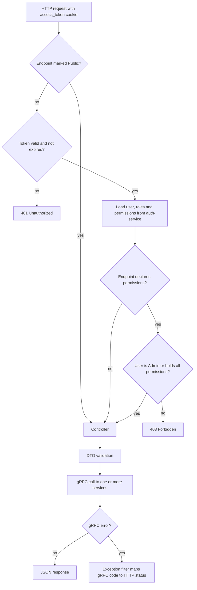

# Gateway

Single HTTP entry point of the platform. It authenticates the browser session, checks platform permissions, validates request bodies and turns each HTTP call into one or more gRPC calls to the backend services, combining their answers when a screen needs data from several of them.

- **Transport**: HTTP (NestJS + Express) towards the frontend; gRPC clients towards the services, generated from `libs/common/src/protos`.
- **Database**: none. It does not own domain data, so it has no `schema.md`.
- **API docs**: Swagger UI at `/api/docs`. Health check at `/health`.

## Boundaries

| Gateway does | Gateway does not |
| --- | --- |
| Read the session cookie, verify the access token and load the user with their platform roles and permissions | Issue or store tokens, users, roles or permissions: that belongs to `auth-service` |
| Enforce platform permissions declared on each endpoint | Check event-level roles (juror, participant) or ownership: services do that where they need it |
| Run the Microsoft sign-in redirect and code exchange, then hand the Microsoft token to `auth-service` | Store project documents itself: files go to Azure Blob Storage |
| Validate request shape with DTOs and map gRPC errors to HTTP status codes | Persist anything: every state change happens in a service |
| Combine data from several services for some screens (rankings, top projects, juror lists, dashboard) | Send emails: services call `notification-service` |

## Modules

| Module | Responsibility | Services it calls |
| --- | --- | --- |
| `auth` | Login, Microsoft sign-in, signup, activation, refresh, logout, password flows, current user | `auth` |
| `users` | Platform user administration | `auth` |
| `events` | Events, courses and categories, awards, inscription details, recaps, members, ranking configuration and rankings | `event`, `auth`, `evaluation`, `invitation` |
| `projects` | Project submission with files, review, participants, juror assignment, documents | `project`, `event`, `evaluation` |
| `criterions` | Evaluation criteria and components | `evaluation` |
| `evaluations` | Evaluate a project, project statistics, top projects per course | `evaluation`, `project` |
| `tiebreaks` | Manual tiebreak order | `evaluation` |
| `invitations` | Invitations, juror invitations, acceptance | `invitation`, `auth`, `event`, `project` |
| `dashboard` | Admin summary figures; student dashboard (`GET /students/me/dashboard`, own data only) | `event`, `project`, `evaluation` (through the other modules) |

Cross-cutting code lives in `src/common`: guards, decorators (`@Public`, `@RequirePermission`, `@GetUser`), the gRPC-to-HTTP exception filter and the cache.

## Authorization model

- **Session**: the access and refresh tokens are httpOnly cookies set by `/auth/*`. The token carries the user id (`sub`) and email; the gateway verifies it with the public key and asks `auth-service` for the user, their platform roles and their permissions on every authenticated request.
- **Endpoint access**: every endpoint requires a session unless it is marked `@Public()`. An endpoint can also declare permissions with `@RequirePermission('action:resource')`; the user must hold all of them. Users with the platform role `Admin` pass every permission check.
- **Inside the services**: services trust the user id the gateway sends. Event-level rules (for example "the juror is assigned to this project") are checked by the service that owns that data.

See [auth-service](../auth-service/) for how tokens are issued and refreshed.

## File uploads

Project submissions and document uploads arrive as `multipart/form-data`. The gateway uploads each file to Azure Blob Storage and sends only the resulting document URL to `project-service`, which stores it with the project.

## Caching

`src/common/cache` holds a Redis-backed cache for GET responses and permission checks, plus admin endpoints under `/admin/cache` to inspect and clear it. It is disabled in code: the Redis client is never initialized (`CacheService` constructor) and the cache interceptors are not registered (`main.ts`). Every request reaches the services and the `/admin/cache` endpoints have no effect.

## Dependencies

- **Uses**: `auth-service`, `event-service`, `project-service`, `evaluation-service` and `invitation-service` over gRPC; Microsoft Entra ID (sign-in); Azure Blob Storage (project files); Redis (cache, disabled in code).
- **Used by**: the frontend.

## Main flow: an authenticated request

## Related

- `libs/common/src/protos`: gRPC contracts of every service.
- Swagger at `/api/docs`: endpoints, request bodies and responses.
- Service docs: [auth-service](../auth-service/), [evaluation-service](../evaluation-service/README.md) and the rest listed in [docs/README.md](../README.md).
