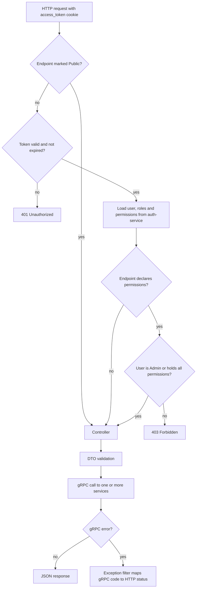

# Gateway

Single HTTP entry point of the platform. It authenticates the browser session, checks platform permissions, validates request bodies and turns each HTTP call into one or more gRPC calls to the backend services, combining their answers when a screen needs data from several of them.

- **Transport**: HTTP (NestJS + Express) towards the frontend; gRPC clients towards the services, generated from `libs/common/src/protos`.
- **Database**: none. It does not own domain data, so it has no `schema.md`.
- **API docs**: Swagger UI at `/api/docs`. Health check at `/health`.

## Boundaries

| Gateway does | Gateway does not |
| --- | --- |
| Read the session cookie, verify the access token and load the user with their platform roles and permissions | Issue or store tokens, users, roles or permissions: that belongs to `auth-service` |
| Enforce platform permissions declared on each endpoint | Decide event-level roles (juror, participant) or ownership: services do that; the gateway asks them first on `owner` endpoints (`CheckProjectAccess`, `AuthorizeInvitation`) |
| Run the Microsoft sign-in redirect and code exchange, then hand the Microsoft token to `auth-service` | Store project documents itself: files go to Azure Blob Storage |
| Validate request shape with DTOs and map gRPC errors to HTTP status codes | Persist anything: every state change happens in a service |
| Combine data from several services for some screens (rankings, top projects, juror lists, dashboard) | Send emails: services call `notification-service` |

## Modules

| Module | Responsibility | Services it calls |
| --- | --- | --- |
| `auth` | Login, Microsoft sign-in, signup, activation, refresh, logout, password flows, current user | `auth` |
| `users` | Platform user administration and platform roles | `auth` |
| `events` | Events, courses and categories, awards, inscription details, recaps, members, ranking configuration, rankings and the public winners page | `event`, `auth`, `evaluation`, `invitation`, `project` |
| `projects` | Project submission with files, review, participants, juror assignment, documents | `project`, `event`, `evaluation` |
| `criterions` | Evaluation criteria and components | `evaluation` |
| `evaluations` | Evaluate a project, project statistics, average per rubric component of an event, top projects per course | `evaluation`, `project` |
| `tiebreaks` | Manual tiebreak order | `evaluation` |
| `invitations` | Invitations, juror invitations, acceptance | `invitation`, `auth`, `event`, `project` |
| `dashboard` | Admin summary figures; student dashboard (`GET /students/me/dashboard`, with `diplomaAvailable` per trajectory event) and results of the student's project (`GET /events/:eventId/my-project/results`), own data only | `event`, `project`, `evaluation` (through the other modules); `diplomas` for `hasDiploma` |
| `diplomas` | Award diploma of a project as a PDF: the caller's own (`GET /events/:eventId/my-project/diploma`) or, through `academic`, one of the director's or dean's scope; see [Award diplomas](#award-diplomas) | `event`, `project` (through the other modules) |
| `academic` | Read-only views of the academic roles (`/academic/*`): projects, their events, registrations, grades (JSON or Excel) and grade statistics of the caller's scope. `GET /academic/profiles` (any session) lists the academic profiles of the caller as an array, one per platform role: `PROFESSOR` (`Professor`), `TUTOR` (`Tutor`), `DIRECTOR` (`DepartmentDirector`), `DEAN` (`Dean`); `[]` for students, Admin and FacultyAdmin without those roles. Every other endpoint takes a required `profile` query parameter: 403 if the caller lacks its role, and `project-service` applies only the scope of that profile (course sections, tutored, department or all), not the union of the caller's scopes. The mapping lives in `academic-profiles.ts`. The profile comes from the role and the scope from its permission: a role whose scope permission is removed in `_role_permissions` still gets the profile and reads an empty list. Grades of unpublished events are only sent to callers with `read:grades`. `/projects/:id` adds the evaluation of the project: how many of its assigned jurors evaluated (always), and, under the same grade rule, the result from `GetProjectResult` (grade, criteria by component with their effective weights, the jurors' comments without author) and the position in the ranking of its category, computed as the ranking does (tied projects share it), with the published awards of the project. If the evaluation cannot be read, the project is still sent with `evaluation: null`. `/projects/:id/diploma` gives the award diploma of the project to the profiles `DIRECTOR` and `DEAN` only (403 for the others), and `diplomaAvailable` in `/projects/:id` tells whether it can be downloaded (see [Award diplomas](#award-diplomas)). `GET /academic/stats` gives, over the evaluated approved projects of an event, the average of each rubric component and criterion and how many final grades fall in each of 5 equal ranges from 0 to the top of the grading scale; `groupBy=department` adds the same per department of the course sections (projects without one under a `null` department), and without `read:grades` it only has numbers once the results are published (`statsHidden`). `/registrations`, `/grades` and `/stats` answer 404 for an event that is not in `/academic/events` (deleted, or without projects of the caller). The course section of a project carries its term code (such as `202610`), taken from `event-service` | `project`, `event`, `evaluation` (through the other modules) |
| `terms` | Academic terms (`GET /terms`, `POST /terms`): every event belongs to one, and the NRC typed when submitting a project is looked up in it when the event requires a course section (`requiresCourse`) | `event` (through the events module) |

Cross-cutting code lives in `src/common`: guards, decorators (`@Public`, `@RequirePermission`, `@RequireAnyPermission`, `@GetUser`), the gRPC-to-HTTP exception filter and the cache.

## Authorization model

- **Session**: the access and refresh tokens are httpOnly cookies set by `/auth/*`. The token carries the user id (`sub`) and email; the gateway verifies it with the public key and asks `auth-service` for the user, their platform roles and their permissions on every authenticated request.
- **Endpoint access**: every endpoint requires a session unless it is marked `@Public()`. An endpoint can also declare permissions with `@RequirePermission('action:resource')`, and the user must hold all of them, or with `@RequireAnyPermission('a:x', 'b:y')`, and one of them is enough (`PUT /projects/:id/tutors` takes `manage:events` or `manage:projects`). Users with the platform role `Admin` pass every permission check.
- **Inside the services**: services trust the user id the gateway sends. Event-level rules (for example "the juror is assigned to this project") are checked by the service that owns that data.
- **Read and write permissions**: reading and changing use different permissions, so read-only roles (the dean) can read without managing: `read:events` for events, rubrics and configuration, `read:grades` for rankings, top projects and tiebreaks, `read:invitations` for invitation lists, `read:academic_projects` for the academic views of `/academic/*`, and `manage:events` to change them. Roles and their permissions are described in [auth-service](../auth-service/README.md#roles-and-permissions).
- **User administration**: `POST /users`, `PATCH /users/:id`, `DELETE /users/:id` and `PUT /users/:id/roles` send the id of the user making the request to `auth-service`, which enforces the administrator rules (a faculty administrator cannot create, edit, deactivate or grant administrators; nobody changes their own roles). `GET /users/roles` lists the roles with their ids.

### Route access policy

`src/common/authorization/route-policy.ts` lists every endpoint with the access it is meant to require, and `route-policy.spec.ts` fails when a controller decorator and the table disagree, when an endpoint is missing from the table, or when the table lists an endpoint that no longer exists. To add an endpoint or change who can call one, change the decorator and the table together.

| Access | Meaning |
| --- | --- |
| `public` | No session |
| `session` | Any authenticated user; `why` explains why that is enough (own data, or data that is not sensitive) |
| `owner` | Only a session in the guard; the service named in `why` checks that the caller owns the resource (participant of the project, assigned juror) or is staff |
| `permission` | All the permissions listed (`@RequirePermission`) |
| `anyPermission` | At least one of the permissions listed (`@RequireAnyPermission`) |

There is no `pending` value: the type does not allow it, so every endpoint has a decision.

### Endpoints checked by the service behind

For `owner` endpoints the guard only asks for a session; the check happens in the service that owns the data, before anything is changed:

| Endpoints | Who passes | Where |
| --- | --- | --- |
| `GET /projects/:id`, `GET /projects/:id/for-review` | Confirmed participants, jurors assigned to the project, `read:events` | `project-service` `CheckProjectAccess` (READ) |
| `PATCH /projects/:id/info`, `PATCH /projects/documents/:id`, `POST /projects/add-update-participants` | Confirmed participants, `manage:events` | `project-service` `CheckProjectAccess` (EDIT); documents are checked before the file is uploaded |
| `PATCH /projects/:id/code`, `POST /projects/:id/change-to-under-review` | Confirmed participants, while the project is in `REQUEST_CHANGES` | gateway use case / `project-service` |
| `POST /invitations` | Depends on the target type | `invitation-service` `AuthorizeInvitation` ([rules](../invitation-service/README.md)); `auth-service` checks a platform grant again on acceptance |
| `GET /events/:eventId/reports/evaluation`, `GET /events/:eventId/my-project/report` | `read:grades`, `read:academic_projects` within scope, or the caller's own project once results are published | `EvaluationReportService` (gateway) |
| `GET /events/:eventId/my-project/diploma` | The caller's own project, once results are published and only if it won an award of the event | `DiplomasService` (gateway) |
| `GET /academic/projects/:id/diploma` | `read:academic_projects` with the profile `DIRECTOR` (its department) or `DEAN` (all); same results and award rules | `AcademicService` + `DiplomasService` (gateway) |

A project tutor reads the projects they tutor through `/academic/projects/:id?profile=TUTOR`, not `GET /projects/:id`. `GET /projects/:id` returns the course section (`academicCourse`, with its term code) to everyone who passes, so the admin panel shows the NRC without an academic profile.

The category report (`GET /events/:eventId/reports/evaluation`) takes an optional `profile`: with it, only the projects of that profile scope (403 without its role), the same ones as the academic screen it is downloaded from; without it, `read:grades` gets the whole category and `read:academic_projects` the union of the caller's scopes.

Some reads stay at `session` because the data is not sensitive and non-staff users need it: `GET /criterions/course/:courseId` (rubric without grades, loaded by jurors) and `GET /events/courses/event/:eventId`, `GET /events/courses/:id` (categories of an event, used by the student project wizard and already public in `/events/public/:id`).

In `POST`/`PATCH /events/award-winners`, the assigner is the caller; the body does not carry it.

See [auth-service](../auth-service/) for how tokens are issued and refreshed.

## Public winners page

`GET /events/public/winners?page=&limit=` is public (no session). It returns the winners and co-winners of every event whose results are published and whose ranking is public, grouped by event, category and award, newest event first, with pagination by event (`limit` at most 50). The visibility rule, the grade rounding and hiding live in event-service `ListPublishedWinners` (see [event-service](../event-service/README.md#public-winners-across-events)); `grade` is `null` unless the event ranking shows grades. The gateway adds each winner's project name from project-service `ListProjectsByIds`.

## Award diplomas

`GET /events/:eventId/my-project/diploma` returns the award diploma of the caller's project as a PDF (A4 landscape), generated on demand and never stored. `GET /academic/projects/:id/diploma?profile=` returns the same PDF for a project of the caller's academic scope.

- **Who**: a student gets the one of their own project in the event (project-service `GetMyProjectByEvent`, 404 otherwise); the academic profiles `DIRECTOR` (projects of their department) and `DEAN` (every project) get the one of any project of their scope (404 outside it), and `PROFESSOR` and `TUTOR` get a 403. In both cases the diploma exists once the admin publishes the results (403 before) and only if it won at least one award of the event (event-service `ListAwardsByProjects`, 404 otherwise). Co-winners each get their own diploma.
- **Content**: the event design, exported from Canva as a PNG with the event title, the dean's signature and the date already printed, plus the project name in Montserrat Bold Italic. The name shrinks from 30 to 16 pt and wraps into at most two lines; a longer name is cut with an ellipsis. A project with several awards gets one diploma: the design does not name the award.
- **Design per event**: `DIPLOMA_TEMPLATES` holds `eventId:template` pairs separated by commas, such as `12:engineering-innovation-expo,15:feria-proyectos-stem`. An event that is not listed answers 404; invalid entries are ignored with a warning at start.
- **Assets**: `src/modules/diplomas/assets` (the PNG designs, the font and its OFL license). `nest-cli.json` copies them next to the bundle, and they are read from `dist/apps/gateway/modules/diplomas/assets` on the first download. A new design is a new PNG of 2000x1414 px with the blank space in the same place, plus its file name in the `DIPLOMA_TEMPLATES` list of `diploma-templates.ts`.
- **In the student dashboard**: `GET /students/me/dashboard` flags each trajectory event with `diplomaAvailable`, `true` when this endpoint would return the diploma: published results, at least one award of the event and a design in `DIPLOMA_TEMPLATES`. The dashboard asks `DiplomasService.hasDiploma(eventId)`, exported by `DiplomasModule`, so both read the same configuration.

## File uploads

Project submissions and document uploads arrive as `multipart/form-data`. The gateway uploads each file to Azure Blob Storage and sends only the resulting document URL to `project-service`, which stores it with the project.

## Caching

`src/common/cache` holds a Redis-backed cache for GET responses and permission checks, plus admin endpoints under `/admin/cache` to inspect and clear it. It is disabled in code: the Redis client is never initialized (`CacheService` constructor) and the cache interceptors are not registered (`main.ts`). Every request reaches the services and the `/admin/cache` endpoints have no effect.

## Dependencies

- **Uses**: `auth-service`, `event-service`, `project-service`, `evaluation-service` and `invitation-service` over gRPC; Microsoft Entra ID (sign-in); Azure Blob Storage (project files); Redis (cache, disabled in code).
- **Used by**: the frontend.

## Main flow: an authenticated request

## Related

- `libs/common/src/protos`: gRPC contracts of every service.
- Swagger at `/api/docs`: endpoints, request bodies and responses.
- Service docs: [auth-service](../auth-service/), [evaluation-service](../evaluation-service/README.md) and the rest listed in [docs/README.md](../README.md).
