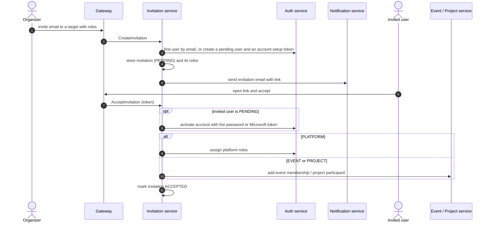

# Invitation Service

Owns invitations to the platform, to an event or to a project. It creates the invitation, sends the email through `notification-service`, and, when the invitation is accepted, orchestrates the account activation and the role or membership the invitation grants.

- **Transport**: gRPC (`InvitationService`). The contract is `libs/common/src/protos/invitation.proto`.
- **Database**: PostgreSQL database `invitation_service`, managed with Prisma. See [schema.md](./schema.md).
- **HTTP**: none. Public endpoints live in the gateway (`/invitations/*`); see Swagger at `/api/docs`.

## Boundaries

| Invitation service does | Invitation service does not |
| --- | --- |
| Store invitations, their target (platform, event or project), status, expiry and the roles to grant | Store users, roles or permissions: it asks `auth-service` |
| Create a pending user in `auth-service` when the invited email has no account | Decide whether a caller may invite: authorization is the gateway's responsibility |
| Send the invitation email through `notification-service` | Render or deliver emails itself |
| On acceptance, activate the account if it is still pending and grant the platform roles, the event membership or the project participation | Store event membership or project participants: those belong to `event-service` and `project-service` |
| Resend invitations and list them by event or by invited user | Expire invitations in the background: expiry is checked when the invitation is read |

## Modules

The service has a single module, `invitations`, following the layering described in `LLM_RULES.md` (`domain`, `application`, `infrastructure`, `interface`).

| Area | Responsibility |
| --- | --- |
| Creation | Create or reuse an invitation, create the pending user if needed, send the email |
| Lookup | Get an invitation by token; list invitations by event or by user |
| Acceptance | Activate the account if it is pending, then apply the target: platform roles, event membership or project participation |
| Resend and rejection | Resend pending or expired invitations; reject by token |

## Email status in the event listing

`GetEventInvitations` (the admin listing of an event) adds `emailStatus` to each invitation: `PENDING` (registered or waiting for a retry), `SENT` or `FAILED` (every attempt failed). It is read from `notification-service` (`GetEmailStatus`) with one call per page (in batches of 100 keys), looking up each invitation by its idempotency key `invitation:<invitationId>:<expiresAt>`; the same function builds it when the email is sent and when the status is read.

`emailStatus` is absent when it is unknown: the invitation has no recorded delivery (it predates the delivery log), or `notification-service` returned an error. In that case the listing still works and the service logs a warning. The call has no timeout: if `notification-service` hangs, the listing waits for it. The other invitation reads (by token, by user) do not carry the field.

## Target types

| Target | `target_id` refers to | On acceptance |
| --- | --- | --- |
| `PLATFORM` | not used | `auth-service` assigns the invitation's platform roles |
| `EVENT` | an event in `event-service` | `event-service` adds the user as an event member with each role |
| `PROJECT` | a project in `project-service` | `project-service` adds the user as a confirmed participant, then `event-service` adds the event membership |
| `PROJECT_TUTOR` | a project in `project-service` | `auth-service` assigns the Tutor platform role (keeping the user's other roles), then `project-service` links the user as tutor of the project; no event membership is created |

## Who may create an invitation (`AuthorizeInvitation`)

Accepting an invitation grants its roles, so creating one is as sensitive as granting them. `POST /invitations` calls `AuthorizeInvitation` (`domain/policies/invitation-access.ts`) before `CreateInvitation`:

| Target | The inviter needs | Roles the invitation may carry |
| --- | --- | --- |
| `PLATFORM` | `create:invitations`, and not inviting their own email | Platform roles that `auth-service` lets the inviter grant (`CheckPlatformRoleGrant`): `Admin` and `FacultyAdmin` only with `manage:admins` |
| `EVENT` | `manage:events` | Event roles (`event-service` rejects the rest on acceptance) |
| `PROJECT` | To be a participant of the project, or `manage:events` (`project-service` `CheckProjectAccess`) | `Participant` only |
| `PROJECT_TUTOR` | Same as `PROJECT` | `Tutor` only |

Errors from `auth-service` and `project-service` keep their gRPC code (403, 404). Invitations that services create themselves (participants when a project is submitted, tutors when it is approved, jurors through `POST /invitations/events/:eventId/jurors`) do not go through this check.

When a `PLATFORM` invitation is accepted, `AssignPlatformRoles` receives the inviter as `actorUserId`, so `auth-service` applies the administrator rules again: an invitation created before these rules cannot give `Admin` to someone the inviter could not make Admin.

## Dependencies

- **Uses**: PostgreSQL, `auth-service` (users, account setup tokens, platform roles), `event-service` (events and membership), `project-service` (projects and participants) and `notification-service` (emails).
- **Used by**: `gateway` and `project-service` (one invitation per participant when a project is submitted).

## Main flow: invitation and acceptance

- The invitation token identifies the invitation. For a new user (`PENDING`) it is the same account setup token issued by `auth-service`, so one link both activates the account and accepts the invitation. A user who already has an active account is sent to the invitations page of the app and accepts while signed in; the account is not touched.
- Only one accepted invitation is allowed per email and target. Creating an invitation while a pending one exists returns the existing one.

## Related

- [schema.md](./schema.md): database schema and ER diagram.
- `libs/common/src/protos/invitation.proto`: gRPC contract.
- `apps/gateway/src/modules/invitations`: HTTP endpoints.
