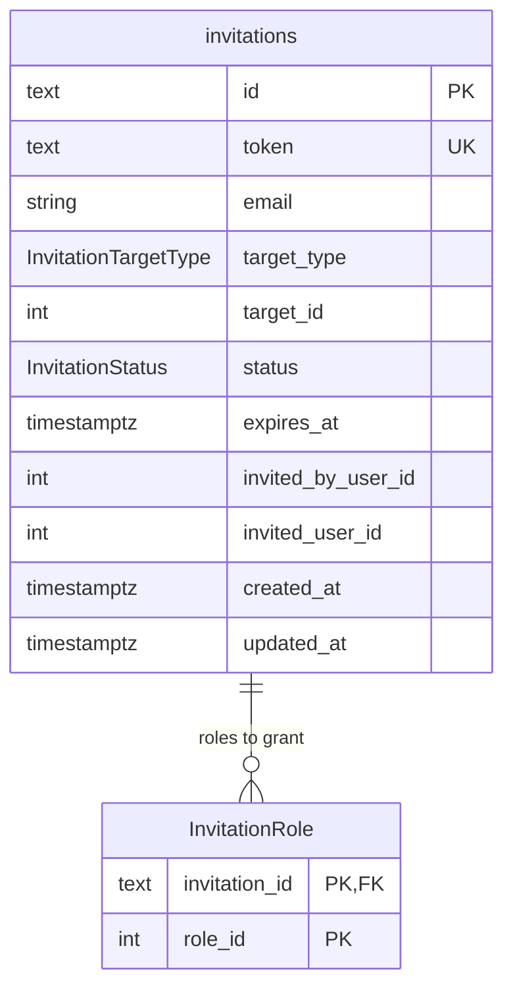

# Invitation Service — Database Schema

Source of truth: `apps/invitation-service/prisma/schema.prisma` (PostgreSQL, one database per service). Physical names use `snake_case` via `@map`/`@@map`, except the `"InvitationRole"` table noted below; the application layer uses `camelCase`. The two migrations (`init_invitations`, `fix_expires_at_timestamp`) were applied to an empty database and produce the same tables, columns, constraints and indexes as the schema.

## ER diagram

Columns follow the order of `schema.prisma`. `PK`, `FK` and `UK` mark constraints; `"nullable"` marks optional columns.

No column is nullable.

## Enums

| Enum | Values | Meaning |
| --- | --- | --- |
| `InvitationStatus` | `PENDING`, `EXPIRED`, `REJECTED`, `ACCEPTED` | `PENDING`: sent and not answered. `EXPIRED`: replaced by a resent invitation. `REJECTED` / `ACCEPTED`: answered. Expiry by date is computed from `expires_at`, not stored as a status. |
| `InvitationTargetType` | `EVENT`, `PLATFORM`, `PROJECT` | What the invitation grants access to; selects how `target_id` is interpreted. |

## Tables

### `invitations` (`Invitation`)

| Column | Type | Null | Default / constraint |
| --- | --- | --- | --- |
| `id` | `TEXT` | no | PK; UUID generated by the application |
| `token` | `TEXT` | no | unique |
| `email` | `VARCHAR(255)` | no | invited email |
| `target_type` | `InvitationTargetType` | no | |
| `target_id` | `INTEGER` | no | event id or project id, depending on `target_type`; not used for `PLATFORM` |
| `status` | `InvitationStatus` | no | no default |
| `expires_at` | `TIMESTAMPTZ` | no | |
| `invited_by_user_id` | `INTEGER` | no | refers to a user in `auth-service` |
| `invited_user_id` | `INTEGER` | no | refers to a user in `auth-service`; set when the invitation is created |
| `created_at` | `TIMESTAMPTZ` | no | `now()` |
| `updated_at` | `TIMESTAMPTZ` | no | maintained by Prisma (`@updatedAt`) |

Relations: 1:N `"InvitationRole"`.

### `"InvitationRole"` (`InvitationRole`)

Roles granted when the invitation is accepted. Primary key is composite (`invitation_id`, `role_id`).

| Column | Type | Null | Default / constraint |
| --- | --- | --- | --- |
| `invitation_id` | `TEXT` | no | PK, FK → `invitations.id` |
| `role_id` | `INTEGER` | no | PK; refers to a role in `auth-service` |

## Foreign keys

| FK | References | On delete |
| --- | --- | --- |
| `"InvitationRole".invitation_id` | `invitations.id` | `RESTRICT` |

The foreign key uses `ON UPDATE CASCADE`. References to other services (`target_id`, `invited_by_user_id`, `invited_user_id`, `role_id`) are logical only; there are no cross-database foreign keys.

## Notes

- The roles table has no `@@map`, so its physical name is `"InvitationRole"` (quoted, PascalCase), unlike `invitations`.
- `target_type` + `target_id` is a polymorphic reference: the same `target_id` value can point to an event or to a project.
- For a new user, `token` holds the account setup token issued by `auth-service`; for an existing user it is a UUID generated by this service.
- Timestamps are `TIMESTAMPTZ`.
- The only indexes are the primary keys and the unique `token`.
