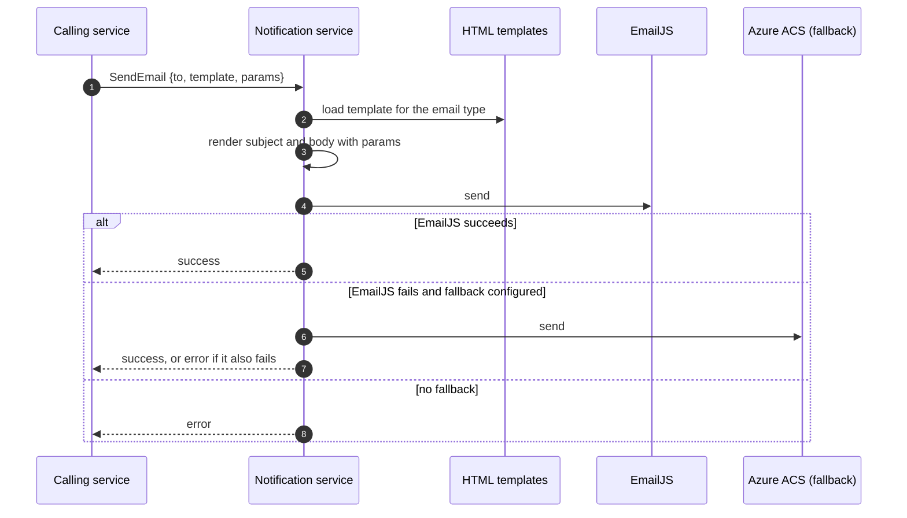

# Notification Service

Sends the platform's transactional emails. Other services ask for an email by template and parameters; this service renders the template and delivers it through an email provider.

- **Transport**: gRPC (`NotificationService`). The contract is `libs/common/src/protos/notification.proto`.
- **Database**: none.
- **HTTP**: none. The gateway does not expose this service.

## Boundaries

| Notification service does | Notification service does not |
| --- | --- |
| Render an HTML template with the parameters it receives (Handlebars; the subject comes from the template's front matter) | Decide which email to send or to whom: the calling service decides |
| Deliver the email through EmailJS, with Azure Communication Services Email as a fallback when configured | Store a history of sent emails or queue them for retry |
| Keep the HTML templates for every email type | Know about users, roles or permissions |

## Modules

The service follows the layering described in `LLM_RULES.md` (`domain`, `application`, `infrastructure`, `interface`).

| Area | Responsibility |
| --- | --- |
| `interface/grpc` | gRPC controller for sending an email |
| `application` | Send-email use case and request DTO |
| `domain` | Email service port |
| `infrastructure/email` | Provider adapter (EmailJS and Azure fallback) and the HTML templates |

## Templates

Each email type of the `EmailTemplate` enum maps to one HTML file in `src/infrastructure/email/templates/`. The file starts with a front matter block that holds the subject, followed by the HTML body. `currentYear` is always available to templates. When adding a template, add the enum value in the proto, the file, and its mapping in the adapter.

## Dependencies

- **Uses**: EmailJS (primary provider) and Azure Communication Services Email (fallback).
- **Used by**: `auth-service` (account and password emails), `invitation-service` (invitation emails) and `project-service` (review result emails).

## Main flow: sending an email

- Each request is a single delivery attempt per provider; the caller receives an error if no provider accepts the email.

## Related

- `libs/common/src/protos/notification.proto`: gRPC contract and the `EmailTemplate` enum.
- `apps/notification-service/src/infrastructure/email/templates`: email templates.
