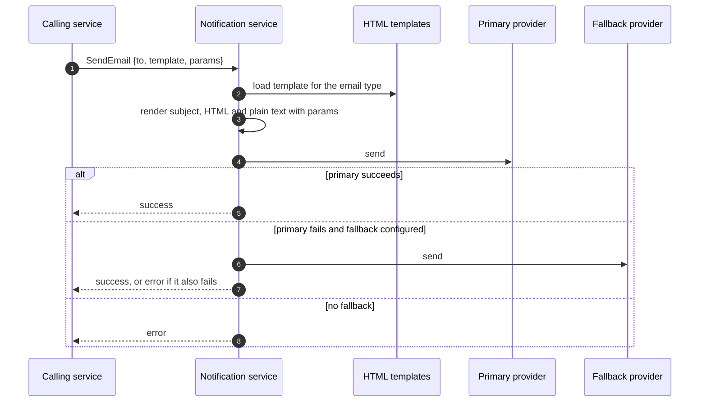

# Notification Service

Sends the platform's transactional emails. Other services ask for an email by template and parameters; this service renders the template and delivers it through an email provider.

- **Transport**: gRPC (`NotificationService`). The contract is `libs/common/src/protos/notification.proto`.
- **Database**: none.
- **HTTP**: none. The gateway does not expose this service.

## Boundaries

| Notification service does | Notification service does not |
| --- | --- |
| Render an HTML template with the parameters it receives (Handlebars; the subject comes from the template's front matter) | Decide which email to send or to whom: the calling service decides |
| Deliver the email through a primary provider and, if it fails, a fallback provider, both chosen by configuration | Store a history of sent emails or queue them for retry |
| Keep the HTML templates for every email type | Know about users, roles or permissions |

## Modules

The service follows the layering described in `LLM_RULES.md`, without a `domain` layer: it has no entities, so it only uses `application`, `infrastructure` and `interface`.

| Area | Responsibility |
| --- | --- |
| `interface/grpc` | gRPC controller for sending an email |
| `application` | Send-email use case, request DTO and the email service port (`application/ports`) |
| `infrastructure/email` | Template renderer, the dispatcher that tries providers in order, one adapter per provider (`providers/`) and the HTML templates |

## Templates

Each email type of the `EmailTemplate` enum maps to one HTML file in `src/infrastructure/email/templates/`. The file starts with a front matter block that holds the subject, followed by the HTML body. `currentYear` is always available to templates. When adding a template, add the enum value in the proto, the file, and its mapping in `email-template.renderer.ts`.

## Email providers

Every provider implements `EmailProvider` (`application/ports/email-provider.port.ts`) in its own adapter under `infrastructure/email/providers/`. `EMAIL_PROVIDERS` is an ordered, comma-separated list: the first configured provider is the primary and the next one is the fallback. The default is `acs,emailjs`.

| Provider | Variables | Behavior |
| --- | --- | --- |
| `acs` | `ACS_CONNECTION_STRING`, `ACS_SENDER_ADDRESS` | Waits for Azure's final status; a send that is not `Succeeded` is a failure. Sends an HTML and a plain-text body. |
| `emailjs` | `EMAILJS_SERVICE_ID`, `EMAILJS_TEMPLATE_ID`, `EMAILJS_PUBLIC_KEY`, `EMAILJS_PRIVATE_KEY` | At most 1 request per second, as primary or fallback. A `429` is retried with a growing wait (1 s, 2 s, 4 s) before it counts as a failure. |

- A listed provider whose variables are missing is skipped with a warning, so the service runs with only one provider. The startup log states the primary and the fallback, or that there is no fallback.
- The service does not start if `EMAIL_PROVIDERS` names an unknown provider or if none of the listed providers is configured.
- Adding a provider means a new adapter and one entry in the registry of `providers/email-providers.ts`.

## Dependencies

- **Uses**: Azure Communication Services Email and EmailJS, in the order set by `EMAIL_PROVIDERS`.
- **Used by**: `auth-service` (account and password emails), `invitation-service` (invitation emails) and `project-service` (review result emails).

## Main flow: sending an email

- Each request is one delivery attempt per provider (EmailJS adds its own retries on `429`); the caller receives an error if no provider accepts the email.

## Related

- `libs/common/src/protos/notification.proto`: gRPC contract and the `EmailTemplate` enum.
- `apps/notification-service/src/infrastructure/email/templates`: email templates.
