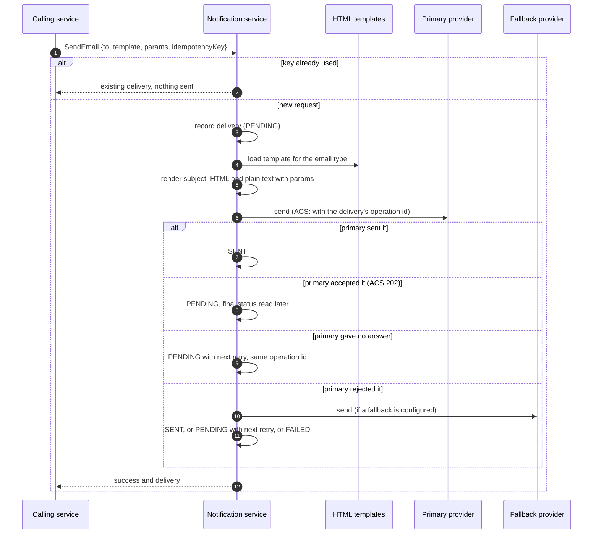

# Notification Service

Sends the platform's transactional emails. Other services ask for an email by template and parameters; this service records the request, renders the template, delivers it through an email provider and retries it if every provider fails.

- **Transport**: gRPC (`NotificationService`). The contract is `libs/common/src/protos/notification.proto`.
- **Database**: PostgreSQL (`notification_service`), see [schema.md](./schema.md).
- **HTTP**: none. The gateway does not expose this service.

## Boundaries

| Notification service does | Notification service does not |
| --- | --- |
| Record every request with its status (pending, sent, failed), provider, attempts and last error, and expose it by gRPC | Decide what a caller does when an email fails |
| Render an HTML template with the parameters it receives (Handlebars; the subject comes from the template's front matter) | Decide which email to send or to whom: the calling service decides |
| Deliver the email through a primary provider and, if it fails, a fallback provider, both chosen by configuration; retry later with a growing wait | Keep the template parameters after the delivery ends |
| Keep the HTML templates for every email type | Know about users, roles or permissions |

## Modules

The service follows the layering described in `LLM_RULES.md`.

| Area | Responsibility |
| --- | --- |
| `domain` | `EmailDelivery` and the retry policy |
| `interface/grpc` | gRPC controller: send an email and look up delivery status |
| `application` | Use cases (send, attempt, retry due deliveries, get status), request DTO and ports (`application/ports`) |
| `infrastructure/email` | Template renderer, the dispatcher that tries providers in order, one adapter per provider (`providers/`) and the HTML templates |
| `infrastructure/persistence` | Prisma repository of `email_deliveries` |
| `infrastructure/scheduling` | Retry worker that polls for due retries |

## Templates

Each email type of the `EmailTemplate` enum maps to one HTML file in `src/infrastructure/email/templates/`. The file starts with a front matter block that holds the subject, followed by the HTML body. `currentYear` is always available to templates. When adding a template, add the enum value in the proto, the file, and its mapping in `email-template.renderer.ts`.

## Email providers

Every provider implements `EmailProvider` (`application/ports/email-provider.port.ts`) in its own adapter under `infrastructure/email/providers/`. `EMAIL_PROVIDERS` is an ordered, comma-separated list: the first configured provider is the primary and the next one is the fallback. The default is `acs,emailjs`.

| Provider | Variables | Behavior |
| --- | --- | --- |
| `acs` | `ACS_CONNECTION_STRING`, `ACS_SENDER_ADDRESS` | Sends with the delivery's operation id and returns once Azure accepts the email (`202`); the final status is read later. Azure rejects a repeated operation id, so a repeated attempt never sends a second email. Sends an HTML and a plain-text body. |
| `emailjs` | `EMAILJS_SERVICE_ID`, `EMAILJS_TEMPLATE_ID`, `EMAILJS_PUBLIC_KEY`, `EMAILJS_PRIVATE_KEY` | At most 1 request per second, as primary or fallback. A `429` is retried with a growing wait (1 s, 2 s, 4 s) before it counts as a failure. |

- A listed provider whose variables are missing, or that cannot be built (a malformed ACS connection string, for example), is skipped and logged, so the service runs with the others. The startup log states the primary and the fallback, or that there is no fallback.
- The service does not start if `EMAIL_PROVIDERS` names an unknown provider or if no listed provider is left after skipping.
- Adding a provider means a new adapter and one entry in the registry of `providers/email-providers.ts`.

## Send log, retries and idempotency

- Every `SendEmail` creates a row in `email_deliveries` and makes the first attempt in the same call. The response carries the delivery (id, status, provider, attempts, last error) and `success`, which is `true` when the email was sent or is queued for a retry and `false` only when it failed for good.
- A failed attempt leaves the row `PENDING` with `next_attempt_at` set to 1, 2, 4... times `EMAIL_RETRY_BASE_DELAY_MS`. The retry worker polls every `EMAIL_RETRY_POLL_MS`, claims each due row and runs the whole provider chain again. After `EMAIL_MAX_ATTEMPTS` attempts (first one included) the row is `FAILED`.
- **Idempotency**: a request may carry an `idempotencyKey`. A second request with the same key returns the first delivery and sends nothing. `invitation-service` uses `invitation:<invitationId>:<expiresAt>`, so a resend (new expiry) sends a new email while a repeated call does not. Requests without a key always send.
- `GetEmailStatus` returns deliveries by id and/or idempotency key.
- Requests are validated by the same `ValidationPipe` as the other services; for example an `idempotencyKey` over 255 characters answers `INVALID_ARGUMENT`.

### What each provider answer does

| Provider answer | Row after the attempt |
| --- | --- |
| Sent (EmailJS `200`, or ACS already reports `Succeeded`) | `SENT` |
| Accepted (ACS `202`) | `PENDING` with `accepted_at`; its final status is read later |
| Rejected: an error before the provider took the email (`4xx`, connection refused) | The next provider in the chain is tried; if every one rejects, `PENDING` with the next retry, or `FAILED` |
| No answer: ACS timeout, `5xx` or connection lost after the request left | `PENDING` with the next retry and the same `provider_ref`; the fallback is not used in this attempt, unless it is the last one |

### No duplicates with ACS

- Before the first ACS send the row saves a new `provider_ref` (a UUID), sent to Azure as the `Operation-Id` header. If it cannot be saved, nothing is sent and the worker takes the row when its lease expires.
- Azure answers a repeated id with `400 OperationIdAlreadyExists` and does not send again. So when an attempt got no answer, the next one reuses the same id: if Azure already had the email, the adapter reads its status instead of sending it twice. A new id is created only after ACS rejected the email or reported it `Failed`.
- If ACS gives no answer twice in a row, or on the last attempt, the email goes to the fallback provider in that attempt. It arrives twice only if the earlier send reached Azure and Azure then stopped answering; on the last attempt a possible duplicate is preferred to no email.
- Azure keeps an operation id for at least several hours (about 7 h when measured), far beyond the default retry delays. A row that waits longer than that before its next attempt (a much larger `EMAIL_RETRY_BASE_DELAY_MS`, or the service down for hours while a send was in doubt) could reuse an id Azure no longer knows, and that send would go out again.

### Confirming an accepted email

An accepted email is never sent again nor handed to another provider. Every `EMAIL_CONFIRM_DELAY_MS` the worker reads its status from the provider that accepted it:

- `Succeeded`: `SENT`.
- `Failed` or `Canceled`: Azure did not send it, so the same attempt goes on with the next provider in the chain (it cannot arrive twice). If that one sends it, `SENT` with the ACS error kept in `last_error`; if not, `PENDING` with the next retry and a new id, or `FAILED` when no attempts are left. It is not counted again.
- Still running, or the read fails: read again later.
- No final status after `EMAIL_CONFIRM_TIMEOUT_MS` since it was accepted: `SENT`, with the reason in `last_error`.

### Saving the outcome

- Sending and saving are separate steps. Once a provider takes the email (sent or accepted), a failure to save the status is tried again twice (after 200 ms and 1 s) and then only logged; it never schedules a retry.
- The row then keeps its lease and its `provider_ref`. With ACS, the next attempt is rejected as repeated and reads the status. EmailJS has no way to ask about an earlier send, so with EmailJS delivery is at least once: if the service stops after EmailJS sent the email and before `SENT` is saved, the worker may send it once more when the lease expires.
- Each row's lease (`ATTEMPT_LEASE_MS`, 5 minutes) starts when the worker claims that row, not when the batch started.

## Dependencies

- **Uses**: Azure Communication Services Email and EmailJS, in the order set by `EMAIL_PROVIDERS`.
- **Used by**: `auth-service` (account and password emails), `invitation-service` (invitation emails) and `project-service` (review result emails).

## Main flow: sending an email

The retry worker repeats the provider chain for due `PENDING` deliveries, or reads the final status of the accepted ones.

## Related

- `libs/common/src/protos/notification.proto`: gRPC contract and the `EmailTemplate` enum.
- `apps/notification-service/src/infrastructure/email/templates`: email templates.
