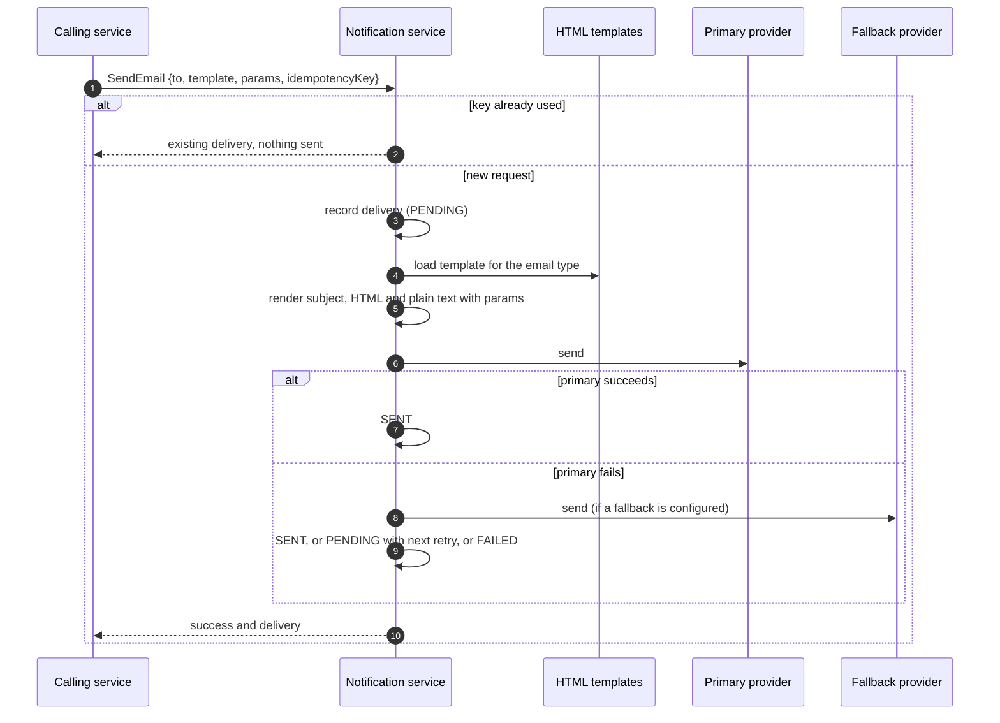

# Notification Service

Sends the platform's transactional emails. Other services ask for an email by template and parameters; this service records the request, renders the template, delivers it through an email provider and retries it if every provider fails.

- **Transport**: gRPC (`NotificationService`). The contract is `libs/common/src/protos/notification.proto`.
- **Database**: PostgreSQL (`notification_service`), see [schema.md](./schema.md).
- **HTTP**: none. The gateway does not expose this service.

## Boundaries

| Notification service does | Notification service does not |
| --- | --- |
| Record every request with its status (pending, sent, failed), provider, attempts and last error, and expose it by gRPC | Decide what a caller does when an email fails |
| Render an HTML template with the parameters it receives (Handlebars; the subject comes from the template's front matter) | Decide which email to send or to whom: the calling service decides |
| Deliver the email through a primary provider and, if it fails, a fallback provider, both chosen by configuration; retry later with a growing wait | Keep the template parameters after the delivery ends |
| Keep the HTML templates for every email type | Know about users, roles or permissions |

## Modules

The service follows the layering described in `LLM_RULES.md`.

| Area | Responsibility |
| --- | --- |
| `domain` | `EmailDelivery` and the retry policy |
| `interface/grpc` | gRPC controller: send an email and look up delivery status |
| `application` | Use cases (send, attempt, retry due deliveries, get status), request DTO and ports (`application/ports`) |
| `infrastructure/email` | Template renderer, the dispatcher that tries providers in order, one adapter per provider (`providers/`) and the HTML templates |
| `infrastructure/persistence` | Prisma repository of `email_deliveries` |
| `infrastructure/scheduling` | Retry worker that polls for due retries |

## Templates

Each email type of the `EmailTemplate` enum maps to one HTML file in `src/infrastructure/email/templates/`. The file starts with a front matter block that holds the subject, followed by the HTML body. `currentYear` is always available to templates. When adding a template, add the enum value in the proto, the file, and its mapping in `email-template.renderer.ts`.

## Email providers

Every provider implements `EmailProvider` (`application/ports/email-provider.port.ts`) in its own adapter under `infrastructure/email/providers/`. `EMAIL_PROVIDERS` is an ordered, comma-separated list: the first configured provider is the primary and the next one is the fallback. The default is `acs,emailjs`.

| Provider | Variables | Behavior |
| --- | --- | --- |
| `acs` | `ACS_CONNECTION_STRING`, `ACS_SENDER_ADDRESS` | Waits for Azure's final status; a send that is not `Succeeded` is a failure. Sends an HTML and a plain-text body. |
| `emailjs` | `EMAILJS_SERVICE_ID`, `EMAILJS_TEMPLATE_ID`, `EMAILJS_PUBLIC_KEY`, `EMAILJS_PRIVATE_KEY` | At most 1 request per second, as primary or fallback. A `429` is retried with a growing wait (1 s, 2 s, 4 s) before it counts as a failure. |

- A listed provider whose variables are missing is skipped with a warning, so the service runs with only one provider. The startup log states the primary and the fallback, or that there is no fallback.
- The service does not start if `EMAIL_PROVIDERS` names an unknown provider or if none of the listed providers is configured.
- Adding a provider means a new adapter and one entry in the registry of `providers/email-providers.ts`.

## Send log, retries and idempotency

- Every `SendEmail` creates a row in `email_deliveries` and makes the first attempt in the same call. The response carries the delivery (id, status, provider, attempts, last error) and `success`, which is `true` when the email was sent or is queued for a retry and `false` only when it failed for good.
- A failed attempt leaves the row `PENDING` with `next_attempt_at` set to 1, 2, 4... times `EMAIL_RETRY_BASE_DELAY_MS`. The retry worker polls every `EMAIL_RETRY_POLL_MS`, claims each due row and runs the whole provider chain again. After `EMAIL_MAX_ATTEMPTS` attempts (first one included) the row is `FAILED`.
- **Idempotency**: a request may carry an `idempotencyKey`. A second request with the same key returns the first delivery and sends nothing. `invitation-service` uses `invitation:<invitationId>:<expiresAt>`, so a resend (new expiry) sends a new email while a repeated call does not. Requests without a key always send.
- `GetEmailStatus` returns deliveries by id and/or idempotency key.
- Delivery is at least once: if the service stops in the middle of an attempt, the row is retried when its lease (`next_attempt_at`) expires, and the email may arrive twice.

## Dependencies

- **Uses**: Azure Communication Services Email and EmailJS, in the order set by `EMAIL_PROVIDERS`.
- **Used by**: `auth-service` (account and password emails), `invitation-service` (invitation emails) and `project-service` (review result emails).

## Main flow: sending an email

The retry worker repeats the same provider chain for due `PENDING` deliveries.

## Related

- `libs/common/src/protos/notification.proto`: gRPC contract and the `EmailTemplate` enum.
- `apps/notification-service/src/infrastructure/email/templates`: email templates.
