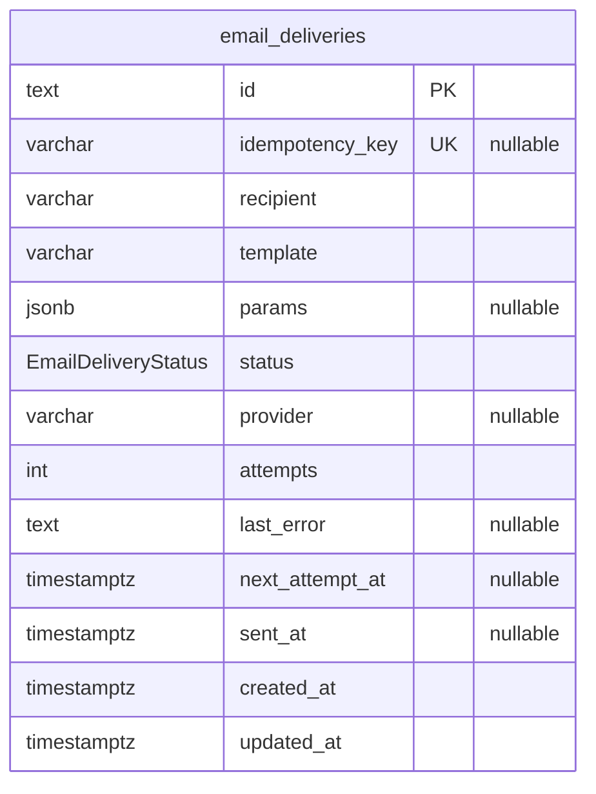

# Notification Service — Database Schema

Source of truth: `apps/notification-service/prisma/schema.prisma` (PostgreSQL, one database per service). Physical names use `snake_case` via `@map`/`@@map`; the application layer uses `camelCase`.

## ER diagram

Columns follow the order of `schema.prisma`. `PK` and `UK` mark constraints; `"nullable"` marks optional columns.

## Enums

| Enum | Values | Meaning |
| --- | --- | --- |
| `EmailDeliveryStatus` | `PENDING`, `SENT`, `FAILED` | `PENDING`: not sent yet; an attempt is running or a retry is scheduled. `SENT`: a provider accepted the email. `FAILED`: every attempt failed. |

## Tables

### `email_deliveries` (`EmailDelivery`)

One row per email request: what was asked, which provider sent it and how it went.

| Column | Type | Null | Default / constraint |
| --- | --- | --- | --- |
| `id` | `TEXT` | no | PK; UUID generated by Prisma |
| `idempotency_key` | `VARCHAR(255)` | yes | unique; set by the caller. A repeated request with the same key returns this row and sends nothing |
| `recipient` | `VARCHAR(320)` | no | destination email |
| `template` | `VARCHAR(64)` | no | `EmailTemplate` name from `notification.proto` |
| `params` | `JSONB` | yes | template parameters; cleared when the status becomes `SENT` or `FAILED`, since they may hold invitation or password-reset links |
| `status` | `EmailDeliveryStatus` | no | `PENDING` |
| `provider` | `VARCHAR(32)` | yes | provider that sent the email, or the last one tried when it failed |
| `attempts` | `INTEGER` | no | `0`; attempts made, the first one included |
| `last_error` | `TEXT` | yes | error of the last failed attempt, one entry per provider tried |
| `next_attempt_at` | `TIMESTAMPTZ(3)` | yes | when the retry worker may take the row; also a lease while an attempt runs. Null once the status is final |
| `sent_at` | `TIMESTAMPTZ(3)` | yes | |
| `created_at` | `TIMESTAMPTZ(3)` | no | `now()` |
| `updated_at` | `TIMESTAMPTZ(3)` | no | maintained by Prisma (`@updatedAt`) |

Indexes: unique on `idempotency_key`; `(status, next_attempt_at)` for the retry worker.

Relations: none. The table has no foreign keys and no references to other services.
