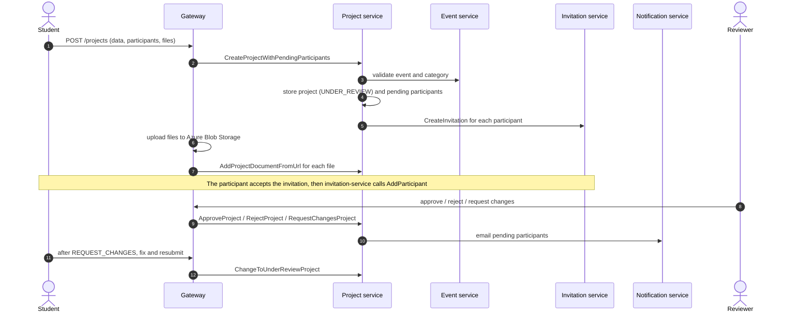

# Project Service

Owns the projects submitted to an event: their review lifecycle, their documents, their participants and the jurors assigned to evaluate them.

- **Transport**: gRPC (`ProjectsService`). The contract is `libs/common/src/protos/project.proto`.
- **Database**: PostgreSQL database `project_service`, managed with Prisma. See [schema.md](./schema.md).
- **HTTP**: none. Public endpoints live in the gateway (`/projects/*`); see Swagger at `/api/docs`.

## Boundaries

| Project service does | Project service does not |
| --- | --- |
| Store projects, their category (`course_id`), code and review state | Store files: the gateway uploads them to Azure Blob Storage and this service keeps the URL |
| Run the review lifecycle (`UNDER_REVIEW`, `APPROVED`, `REJECTED`, `REQUEST_CHANGES`) | Evaluate or score projects: that belongs to `evaluation-service` |
| Keep pending participants (captured at submission) and confirmed participants (linked to a user) | Manage user accounts or event membership: that belongs to `auth-service` and `event-service` |
| Assign jurors to projects using the event membership key (user, event, role) | Own the evaluation scale: `evaluation-service` resolves it from the project's `eventId` through `event-service` |
| Request one invitation per participant when a project is submitted | Send invitations or emails itself: it calls `invitation-service` and `notification-service` |
| Keep the academic structure (departments and course sections by NRC and term) that scopes what Professors and Department Directors can read; loaded by scripts for now | Own the academic terms: they live in `event-service`, and a course section keeps only the term id |
| Link every project to a course section: the NRC typed at submission is looked up in the term of the event, or course section 0 when the event does not require one | |

## Modules

The service has a single module, `projects`, following the layering described in `LLM_RULES.md` (`domain`, `application`, `infrastructure`, `interface`).

| Area | Responsibility |
| --- | --- |
| Projects | Creation, update, listing by event, project detail, dashboard count, student participation statistics, projects by ids (`ListProjectsByIds`) |
| Review | Approve, reject, request changes, send back to review |
| Documents | Logo, poster and supporting documents, stored as the blob name of their file. An administrator (`manage:projects`) replaces the file or sets the state ACTIVE/INACTIVE (`AdminReplaceProjectDocument`, `AdminChangeProjectDocumentState`), recorded in the change log as DOCUMENTS. INACTIVE documents are left out of every read (listings, detail, review, the student's own project, the open link); only `ListProjectDocuments` with `includeInactive` (`GET /projects/:id/admin/documents`) lists them. `UpdateProjectDocument` (`PATCH /projects/documents/:id`) changes the file or type only: never the state, and never an INACTIVE document |
| Participants | Pending participants and confirmed participants |
| Jurors | Assign, reassign, remove and list jurors; projects assigned to a juror |

## Project access (`CheckProjectAccess`)

The gateway only asks for a session on the endpoints that read or edit one project and calls `CheckProjectAccess` (`domain/project-access.ts`) first. It answers `PERMISSION_DENIED` unless the user:

| Action | Allowed |
| --- | --- |
| `PROJECT_ACCESS_READ` (`GET /projects/:id`, `GET /projects/:id/for-review`) | a confirmed participant, a juror assigned to the project, or a user with `read:events` |
| `PROJECT_ACCESS_EDIT` (`PATCH /projects/:id/info`, `PATCH /projects/documents/:id`, `POST /projects/add-update-participants`, and project invitations in `invitation-service`) | a confirmed participant, or a user with `manage:events` |

Admin passes like in the gateway guard. Pending participants (not joined yet) do not count. With `documentId` the project of the document is checked. Permissions come from `auth-service` (`GetUserPermissions`), only when the user is not a participant.

`ChangeToUnderReviewProject` checks the participant on its own; `PATCH /projects/:id/code` is checked in the gateway use case.

## Dependencies

- **Uses**: PostgreSQL, `auth-service` (platform permissions for `CheckProjectAccess`, Tutor role), `event-service` (event and category validation, events and awards for the student dashboard), `invitation-service` (participant invitations) and `notification-service` (review emails).
- **Used by**: `gateway`, `invitation-service` (accepting project invitations) and `evaluation-service` (project and juror lookup).

## Main flow: submission and review



- Approved and rejected are final states. A project in `REQUEST_CHANGES` goes back to `UNDER_REVIEW` when a confirmed participant resubmits it.
- A juror is identified by the same composite key as an event member in `event-service`: user, event and role.

## Student participation statistics

`GetStudentParticipationStats` feeds the student dashboard (`GET /students/me/dashboard` in the gateway, which always sends the session user id and shapes the response for the frontend).

- **Counted projects**: only `APPROVED` projects where the user is a confirmed participant (`project_participants`).
- **Events**: read from `event-service` with `ListEventsByIds`. Deleted events (`active = false`) are left out. Events that already ended (status `CLOSED`) are marked `finished` (historical); the rest are ongoing.
- **Semester**: derived from the event start date in Bogota time, `AAAA-10` from January to June and `AAAA-30` from July to December.
- **Awards**: read with `ListAwardsByProjects`; only awards of active categories in the project's own event count, co-winners once each, and only once the admin publishes the event results (`event.results_published`), the same rule as the scores.
- **Current project**: the user's project in an event that has not ended and was not deleted, in any review state (so the student sees whether it is pending, approved or needs changes). With several: a rejected project never displaces another one, an event in progress goes before an upcoming one, then the event in progress that started last or the upcoming one that starts first. `canEdit` is true only for `REQUEST_CHANGES`. It carries the team size (participants captured at submission) and the number of active documents.
- **Category name**: read with one `ListCategoriesByIds` call; if it fails or a category is missing, the name stays empty.
- **Academic data**: derived from all the user's participations, as in `ListUserParticipations` (the request carries the session email), so the dashboard needs a single call.
- **Response**: totals (events, finished and ongoing events, projects, awards), `bySemester` from the oldest semester, `participations` from the most recent event, `currentProject` when there is one, and `academic`. Each participation and the current project say whether the event results are published (`event.results_published`), so the gateway only adds scores to those.

## Academic read scope

`ListProjectsInScope`, `GetProjectInScope` and `ListEventIdsInScope` serve the read-only `/academic/*` endpoints of the gateway. The gateway only lets in callers with `read:academic_projects`; the projects each one reads come from the scope permissions that `auth-service` returns for the caller (`GetUserPermissions`, active roles only), not from anything the gateway sends:

| Permission | Projects | Granted to |
| --- | --- | --- |
| `read_all:academic_projects` | All | `Admin`, `FacultyAdmin`, `Dean` |
| `read_tutored:academic_projects` | The ones in `project_tutors` with the user | `Tutor` |
| `read_course:academic_projects` | The ones of the course sections (`academic_courses`) the user teaches | `Professor` |
| `read_department:academic_projects` | The ones of the course sections of the department the user directs | `DepartmentDirector` |

- A user with several of them reads the union. No role id is fixed in the code: giving or removing a scope to a role is a row in `auth-service` `_role_permissions`.
- `Admin` holds `read_all` explicitly: the Admin bypass of the gateway guard does not reach this service.
- A project outside the scope answers `NOT_FOUND`, like a missing one.
- The projects in a fill course section (see [schema.md](./schema.md)), -1 (created before course sections existed) or 0 (event that does not require one), are only seen by their tutors and `read_all`, and are returned without `academicCourse`.

### Course section of a new project

The event says whether its projects need a course section (`event-service` `requires_course`, set when the event is created). `CreateProject` and `CreateProjectWithPendingParticipants` read it from `event-service`:

| Event | Course section of the project |
| --- | --- |
| Requires one (a final projects fair) | The `nrc` sent is looked up in the term of the event by (term, NRC), since the same NRC repeats across terms. A missing NRC, one that does not exist in that term, the fill rows 0 and -1, and an event that still has no term (term -1) are rejected (`INVALID_ARGUMENT`) |
| Does not require one (a hackathon) | Course section 0 ("No aplica"), assigned by the service; an `nrc` sent is ignored |
| Created before course sections existed | Course section -1, set by the migration |

`academic_course_id` stays `NOT NULL`. The rule "0 only for an event that does not require a course section" is checked in `create-project.uc.ts`, not by a constraint, because the event lives in another database. An event that does not say whether it requires one is treated as requiring it.

### Loading departments and course sections

There is no screen for this yet. `scripts/academic-structure/load-academic-structure.ts` loads departments (with their director), course sections by term and NRC (with their professor and department) and the course section of each project from a JSON file; `scripts/academic-structure/example.json` shows the format. Users are given by email and terms as `year` and `period` (2026 + `"10"` is 202610).

```
# bash
AUTH_DATABASE_URL=<auth db url> EVENT_DATABASE_URL=<event db url> PROJECT_DATABASE_URL=<project db url> pnpm exec ts-node scripts/academic-structure/load-academic-structure.ts <file.json> --dry-run
# PowerShell
$env:AUTH_DATABASE_URL="<auth db url>"; $env:EVENT_DATABASE_URL="<event db url>"; $env:PROJECT_DATABASE_URL="<project db url>"
pnpm exec ts-node scripts/academic-structure/load-academic-structure.ts <file.json> --dry-run
```

- It checks the whole file first (unknown emails, projects, departments or terms, repeated rows, a user directing two departments); with any error nothing is written. Users without the matching role (`Professor`, `DepartmentDirector`) only raise a warning, because they will not see anything until the role is granted.
- A term must exist in `event-service` before it is used (`POST /terms`). A project is linked only to a course section of the term of its event; for an old event, set its term first (`PATCH /events/:id` with `termId`).
- A department listed without `directorEmail` keeps the director it has; `"directorEmail": null` leaves it without director. This lets a later file list a department only to add course sections to it.
- The fill rows (department -1 "Sin departamento", course sections -1 "Sin NRC" and 0 "No aplica") cannot be named or changed from the file. A project of an event that does not require a course section cannot be linked to one: it keeps course section 0.
- Without `--dry-run` it writes everything in one transaction. Departments are matched by name and course sections by (term, NRC); existing ones take the values of the file. Nothing is deleted, and running the same file again changes nothing.
- It only reads `auth-service` and `event-service`; roles are granted from the user administration (`PUT /users/:id/roles`).

## Writes that go together

An edit and its change log entry are saved together with `UnitOfWork.run`: the use case calls `ProjectChangeLogRepository.create` inside it, next to the edit. How it works and its rules: [transactions.md](../transactions.md).

## Related

- [schema.md](./schema.md): database schema and ER diagram.
- `libs/common/src/protos/project.proto`: gRPC contract.
- `apps/gateway/src/modules/projects`: HTTP endpoints and file uploads.
