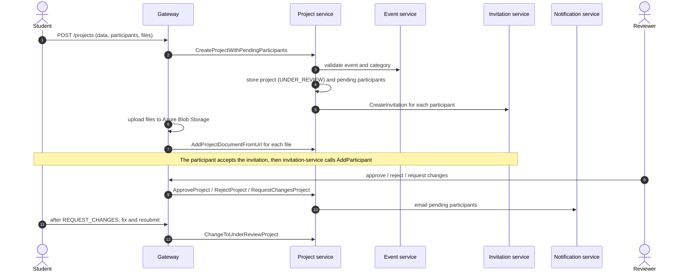

# Project Service

Owns the projects submitted to an event: their review lifecycle, their documents, their participants and the jurors assigned to evaluate them.

- **Transport**: gRPC (`ProjectsService`). The contract is `libs/common/src/protos/project.proto`.
- **Database**: PostgreSQL database `project_service`, managed with Prisma. See [schema.md](./schema.md).
- **HTTP**: none. Public endpoints live in the gateway (`/projects/*`); see Swagger at `/api/docs`.

## Boundaries

| Project service does | Project service does not |
| --- | --- |
| Store projects, their category (`course_id`), code and review state | Store files: the gateway uploads them to Azure Blob Storage and this service keeps the URL |
| Run the review lifecycle (`UNDER_REVIEW`, `APPROVED`, `REJECTED`, `REQUEST_CHANGES`) | Evaluate or score projects: that belongs to `evaluation-service` |
| Keep pending participants (captured at submission) and confirmed participants (linked to a user) | Manage user accounts or event membership: that belongs to `auth-service` and `event-service` |
| Assign jurors to projects using the event membership key (user, event, role) | Own the evaluation scale: `evaluation-service` resolves it from the project's `eventId` through `event-service` |
| Request one invitation per participant when a project is submitted | Send invitations or emails itself: it calls `invitation-service` and `notification-service` |

## Modules

The service has a single module, `projects`, following the layering described in `LLM_RULES.md` (`domain`, `application`, `infrastructure`, `interface`).

| Area | Responsibility |
| --- | --- |
| Projects | Creation, update, listing by event, project detail, dashboard count, student participation statistics |
| Review | Approve, reject, request changes, send back to review |
| Documents | Logo, poster and supporting documents stored as URLs |
| Participants | Pending participants and confirmed participants |
| Jurors | Assign, reassign, remove and list jurors; projects assigned to a juror |

## Dependencies

- **Uses**: PostgreSQL, `event-service` (event and category validation, events and awards for the student dashboard), `invitation-service` (participant invitations) and `notification-service` (review emails).
- **Used by**: `gateway`, `invitation-service` (accepting project invitations) and `evaluation-service` (project and juror lookup).

## Main flow: submission and review

- Approved and rejected are final states. A project in `REQUEST_CHANGES` goes back to `UNDER_REVIEW` when a confirmed participant resubmits it.
- A juror is identified by the same composite key as an event member in `event-service`: user, event and role.

## Student participation statistics

`GetStudentParticipationStats` feeds the student dashboard (IRIS-V3-STD-01, `GET /students/me/dashboard` in the gateway, which always sends the session user id and shapes the response for the frontend).

- **Counted projects**: only `APPROVED` projects where the user is a confirmed participant (`project_participants`).
- **Events**: read from `event-service` with `ListEventsByIds`. Deleted events (`active = false`) are left out. Events that already ended (status `CLOSED`) are marked `finished` (historical); the rest are ongoing.
- **Semester**: derived from the event start date in Bogota time, `AAAA-10` from January to June and `AAAA-30` from July to December.
- **Awards**: read with `ListAwardsByProjects`; only awards of the project's own event count, co-winners once each.
- **Current project**: the user's project in an event that has not ended and was not deleted, in any review state (so the student sees whether it is pending, approved or needs changes). With several, the most recent event. `canEdit` is true only for `REQUEST_CHANGES`. It carries the team size (participants captured at submission) and the number of active documents.
- **Category name**: read with `GetCourse` for each category of the user's projects; a missing one leaves the name empty.
- **Response**: totals (events, finished and ongoing events, projects, awards), `bySemester` from the oldest semester, `participations` from the most recent event, and `currentProject` when there is one.

## Related

- [schema.md](./schema.md): database schema and ER diagram.
- `libs/common/src/protos/project.proto`: gRPC contract.
- `apps/gateway/src/modules/projects`: HTTP endpoints and file uploads.
