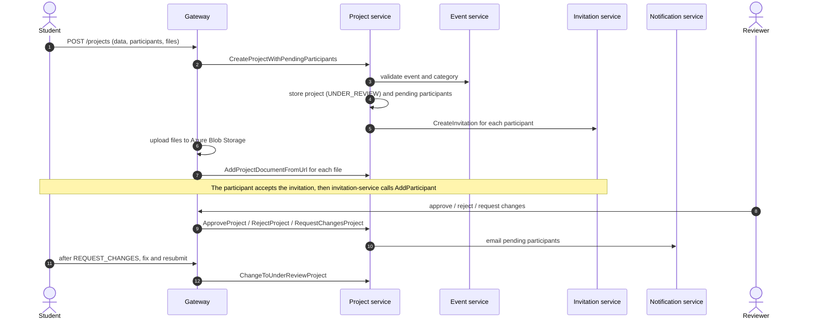

# Project Service

Owns the projects submitted to an event: their review lifecycle, their documents, their participants and the jurors assigned to evaluate them.

- **Transport**: gRPC (`ProjectsService`). The contract is `libs/common/src/protos/project.proto`.
- **Database**: PostgreSQL database `project_service`, managed with Prisma. See [schema.md](./schema.md).
- **HTTP**: none. Public endpoints live in the gateway (`/projects/*`); see Swagger at `/api/docs`.

## Boundaries

| Project service does | Project service does not |
| --- | --- |
| Store projects, their category (`course_id`), code and review state | Store files: the gateway uploads them to Azure Blob Storage and this service keeps the URL |
| Run the review lifecycle (`UNDER_REVIEW`, `APPROVED`, `REJECTED`, `REQUEST_CHANGES`) | Evaluate or score projects: that belongs to `evaluation-service` |
| Keep pending participants (captured at submission) and confirmed participants (linked to a user) | Manage user accounts or event membership: that belongs to `auth-service` and `event-service` |
| Assign jurors to projects using the event membership key (user, event, role) | Own the evaluation scale: `evaluation-service` resolves it from the project's `eventId` through `event-service` |
| Request one invitation per participant when a project is submitted | Send invitations or emails itself: it calls `invitation-service` and `notification-service` |

## Modules

The service has a single module, `projects`, following the layering described in `LLM_RULES.md` (`domain`, `application`, `infrastructure`, `interface`).

| Area | Responsibility |
| --- | --- |
| Projects | Creation, update, listing by event, project detail, dashboard count |
| Review | Approve, reject, request changes, send back to review |
| Documents | Logo, poster and supporting documents stored as URLs |
| Participants | Pending participants and confirmed participants |
| Jurors | Assign, reassign, remove and list jurors; projects assigned to a juror |

## Dependencies

- **Uses**: PostgreSQL, `event-service` (event and category validation), `invitation-service` (participant invitations) and `notification-service` (review emails).
- **Used by**: `gateway`, `invitation-service` (accepting project invitations) and `evaluation-service` (project and juror lookup).

## Main flow: submission and review

- Approved and rejected are final states. A project in `REQUEST_CHANGES` goes back to `UNDER_REVIEW` when a confirmed participant resubmits it.
- A juror is identified by the same composite key as an event member in `event-service`: user, event and role.

## Related

- [schema.md](./schema.md): database schema and ER diagram.
- `libs/common/src/protos/project.proto`: gRPC contract.
- `apps/gateway/src/modules/projects`: HTTP endpoints and file uploads.
