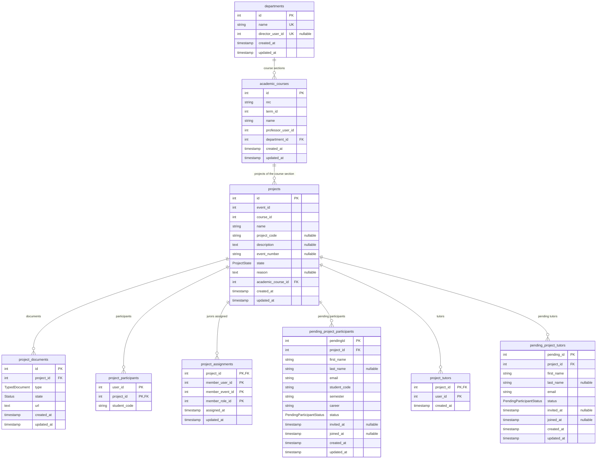

# Project Service — Database Schema

Source of truth: `apps/project-service/prisma/schema.prisma` (PostgreSQL, one database per service). Physical names use `snake_case` via `@map`/`@@map`, with one exception noted below; the application layer uses `camelCase`. The migrations were applied to an empty database and produce the same tables, columns, constraints and indexes as the schema; the only difference is the order of the `TypedDocument` values (`LOGO` was added last).

## ER diagram

Columns follow the order of `schema.prisma`. `PK` and `FK` mark constraints; `"nullable"` marks optional columns. Composite unique constraints are listed below the diagram, not marked on each column.

`projects` has a composite unique constraint on (`event_id`, `name`). `pending_project_participants` and `pending_project_tutors` have a composite unique constraint on (`project_id`, `email`). `academic_courses` has a composite unique constraint on (`term_id`, `nrc`).

## Enums

| Enum | Values | Meaning |
| --- | --- | --- |
| `ProjectState` | `UNDER_REVIEW`, `APPROVED`, `REJECTED`, `REQUEST_CHANGES` | Review state of a project. New projects start in `UNDER_REVIEW`. |
| `TypedDocument` | `LOGO`, `POSTER`, `SUPPORTING_DOCUMENT` | Kind of project document. |
| `Status` | `ACTIVE`, `INACTIVE` | Whether a document is in use. Default `ACTIVE`. |
| `PendingParticipantStatus` | `PENDING`, `INVITED`, `JOINED` | `PENDING`: captured at submission. `JOINED`: accepted the invitation and became a confirmed participant. `INVITED` is defined but not currently assigned. |

## Tables

### `projects` (`Project`)

| Column | Type | Null | Default / constraint |
| --- | --- | --- | --- |
| `id` | `SERIAL` | no | PK |
| `event_id` | `INTEGER` | no | unique together with `name`; refers to an event in `event-service` |
| `course_id` | `INTEGER` | no | refers to an event category in `event-service` (legacy name) |
| `name` | `VARCHAR(255)` | no | unique together with `event_id` |
| `project_code` | `VARCHAR(50)` | yes | |
| `description` | `TEXT` | yes | |
| `event_number` | `VARCHAR(150)` | yes | |
| `state` | `ProjectState` | no | no default |
| `reason` | `TEXT` | yes | reason of the last rejection or change request |
| `academic_course_id` | `INTEGER` | no | FK → `academic_courses.id`; indexed. Course section (NRC) of the project; 0 when its event does not require one, -1 for the projects created before course sections existed |
| `created_at` | `TIMESTAMP` | no | `now()` |
| `updated_at` | `TIMESTAMP` | no | maintained by Prisma (`@updatedAt`) |

Relations: N:1 `academic_courses`; 1:N `project_documents`, `project_participants`, `project_assignments`, `pending_project_participants`, `project_tutors`, `pending_project_tutors`.

### `project_documents` (`ProjectDocument`)

| Column | Type | Null | Default / constraint |
| --- | --- | --- | --- |
| `id` | `SERIAL` | no | PK |
| `project_id` | `INTEGER` | no | FK → `projects.id` |
| `type` | `TypedDocument` | no | |
| `state` | `Status` | no | `ACTIVE` |
| `url` | `TEXT` | no | URL of the file in Azure Blob Storage |
| `created_at` | `TIMESTAMP` | no | `now()` |
| `updated_at` | `TIMESTAMP` | no | `@updatedAt` |

### `project_participants` (`ProjectParticipant`)

Confirmed participants: users who accepted the project invitation. Primary key is composite (`user_id`, `project_id`).

| Column | Type | Null | Default / constraint |
| --- | --- | --- | --- |
| `user_id` | `INTEGER` | no | PK; refers to a user in `auth-service` |
| `project_id` | `INTEGER` | no | PK, FK → `projects.id` |
| `student_code` | `VARCHAR(20)` | no | |

### `project_assignments` (`ProjectAssignment`)

Jurors assigned to a project. The juror is identified by the event membership key used in `event-service` (`member_user_id`, `member_event_id`, `member_role_id`). Primary key is composite over the project and those three columns.

| Column | Type | Null | Default / constraint |
| --- | --- | --- | --- |
| `project_id` | `INTEGER` | no | PK, FK → `projects.id` |
| `member_user_id` | `INTEGER` | no | PK |
| `member_event_id` | `INTEGER` | no | PK |
| `member_role_id` | `INTEGER` | no | PK |
| `assigned_at` | `TIMESTAMP` | no | `now()` |
| `updated_at` | `TIMESTAMP` | no | `@updatedAt` |

### `pending_project_participants` (`PendingProjectParticipant`)

Participants captured when the project is submitted, before they have an account or accept the invitation.

| Column | Type | Null | Default / constraint |
| --- | --- | --- | --- |
| `pendingId` | `SERIAL` | no | PK |
| `project_id` | `INTEGER` | no | FK → `projects.id`; unique together with `email` |
| `first_name` | `VARCHAR(100)` | no | |
| `last_name` | `VARCHAR(100)` | yes | |
| `email` | `VARCHAR(255)` | no | unique together with `project_id` |
| `student_code` | `VARCHAR(20)` | no | |
| `semester` | `VARCHAR(50)` | no | `'1'` |
| `career` | `VARCHAR(255)` | no | `'N/A'` |
| `status` | `PendingParticipantStatus` | no | `PENDING` |
| `invited_at` | `TIMESTAMP` | yes | |
| `joined_at` | `TIMESTAMP` | yes | |
| `created_at` | `TIMESTAMP` | no | `now()` |
| `updated_at` | `TIMESTAMP` | no | `@updatedAt` |

### `project_tutors` (`ProjectTutor`)

Platform users linked to a project as tutors. `user_id` belongs to the auth-service database.

| Column | Type | Null | Default / constraint |
| --- | --- | --- | --- |
| `project_id` | `INTEGER` | no | PK (with `user_id`), FK → `projects.id` |
| `user_id` | `INTEGER` | no | PK (with `project_id`) |
| `created_at` | `TIMESTAMP` | no | `now()` |

### `pending_project_tutors` (`PendingProjectTutor`)

Tutors typed in at submission who have no account yet; marked `JOINED` when their invitation is accepted.

| Column | Type | Null | Default / constraint |
| --- | --- | --- | --- |
| `pending_id` | `SERIAL` | no | PK |
| `project_id` | `INTEGER` | no | FK → `projects.id`; unique together with `email` |
| `first_name` | `VARCHAR(100)` | no | |
| `last_name` | `VARCHAR(100)` | yes | |
| `email` | `VARCHAR(255)` | no | unique together with `project_id` |
| `status` | `PendingParticipantStatus` | no | `PENDING` |
| `invited_at` | `TIMESTAMP` | yes | |
| `joined_at` | `TIMESTAMP` | yes | |
| `created_at` | `TIMESTAMP` | no | `now()` |
| `updated_at` | `TIMESTAMP` | no | `@updatedAt` |

### `departments` (`Department`)

Academic departments. A department has at most one director and a user directs at most one department; the director reads the projects of the course sections of the department. Loaded by scripts for now. Row -1 ("Sin departamento", no director) holds the fill course sections -1 and 0.

| Column | Type | Null | Default / constraint |
| --- | --- | --- | --- |
| `id` | `SERIAL` | no | PK |
| `name` | `VARCHAR(255)` | no | unique |
| `director_user_id` | `INTEGER` | yes | unique; refers to a user in `auth-service` |
| `created_at` | `TIMESTAMP` | no | `now()` |
| `updated_at` | `TIMESTAMP` | no | `@updatedAt` |

Relations: 1:N `academic_courses`.

### `academic_courses` (`AcademicCourse`)

Course sections, identified by their NRC within an academic term (the NRC repeats across terms). Each section has one professor, who reads the projects of the section. Loaded by scripts for now. Not to be confused with `projects.course_id`, which is an event category in `event-service`.

Fill rows, both in term -1, department -1 and with professor 0 (no user has that id: a real id would make that user the professor of all those projects):

| id | name | Meaning |
| --- | --- | --- |
| -1 | Sin NRC | "We do not know its course": the projects created before course sections existed |
| 0 | No aplica | "It has no course": the projects of an event that does not require one (`event-service` `requires_course = false`). `create-project.uc.ts` only allows it for such an event, since a constraint cannot cross to the `event-service` database |

| Column | Type | Null | Default / constraint |
| --- | --- | --- | --- |
| `id` | `SERIAL` | no | PK |
| `nrc` | `VARCHAR(20)` | no | unique together with `term_id` |
| `term_id` | `INTEGER` | no | unique together with `nrc`; refers to a term in `event-service` |
| `name` | `VARCHAR(255)` | no | |
| `professor_user_id` | `INTEGER` | no | indexed; refers to a user in `auth-service` |
| `department_id` | `INTEGER` | no | FK → `departments.id`; indexed |
| `created_at` | `TIMESTAMP` | no | `now()` |
| `updated_at` | `TIMESTAMP` | no | `@updatedAt` |

Relations: N:1 `departments`; 1:N `projects`.

## Foreign keys

| FK | References | On delete |
| --- | --- | --- |
| `project_documents.project_id` | `projects.id` | `RESTRICT` |
| `project_participants.project_id` | `projects.id` | `RESTRICT` |
| `project_assignments.project_id` | `projects.id` | `RESTRICT` |
| `pending_project_participants.project_id` | `projects.id` | `RESTRICT` |
| `project_tutors.project_id` | `projects.id` | `CASCADE` |
| `pending_project_tutors.project_id` | `projects.id` | `CASCADE` |
| `projects.academic_course_id` | `academic_courses.id` | `RESTRICT` |
| `academic_courses.department_id` | `departments.id` | `RESTRICT` |

All foreign keys use `ON UPDATE CASCADE`. References to other services (`event_id`, `course_id`, `user_id`, `member_*`, `term_id`, `professor_user_id`, `director_user_id`) are logical only; there are no cross-database foreign keys.

## Notes

- `pending_project_participants.pendingId` is the only column without a `snake_case` mapping, so its physical name is `"pendingId"` (quoted, camelCase).
- Deleting a project requires deleting its documents, participants, assignments and pending participants first, because those foreign keys are `RESTRICT`. Tutors and pending tutors are deleted with the project (`CASCADE`).
- Timestamps are `TIMESTAMP` without time zone.
- `semester` and `career` were added later with the defaults `'1'` and `'N/A'`, which were also used to fill existing rows.
- A course section with projects, or a department with course sections, cannot be deleted (`RESTRICT`).
- `academic_course_id` was added with the fill rows (department -1, course sections -1 and 0): the existing projects took course section -1 and then the column became `NOT NULL`. The explicit ids leave the sequences untouched, so the real rows start at 1.
- Besides the primary keys and the unique constraints, there are indexes on `projects.academic_course_id`, `academic_courses.professor_user_id` and `academic_courses.department_id`.
