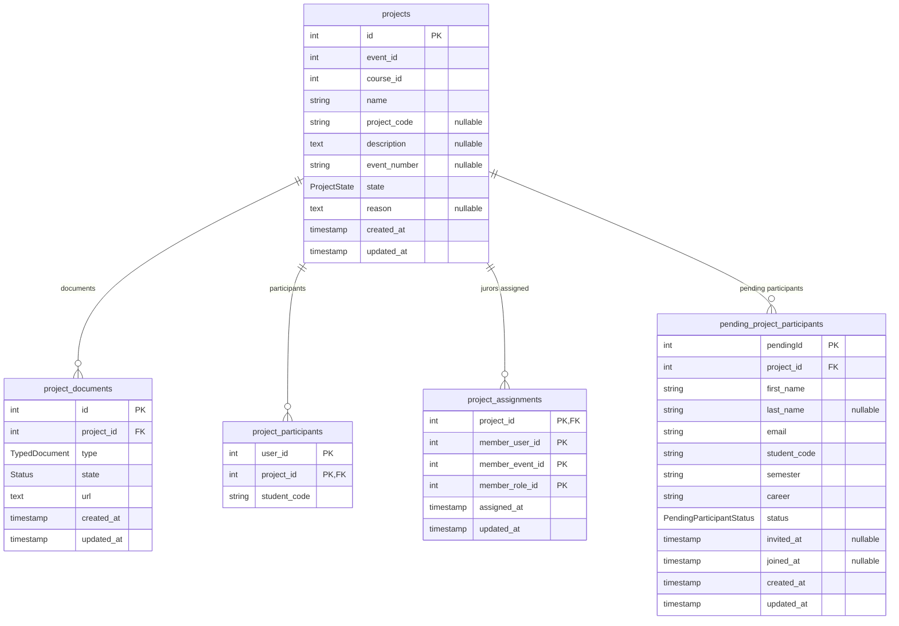

# Project Service — Database Schema

Source of truth: `apps/project-service/prisma/schema.prisma` (PostgreSQL, one database per service). Physical names use `snake_case` via `@map`/`@@map`, with one exception noted below; the application layer uses `camelCase`. The migrations were applied to an empty database and produce the same tables, columns, constraints and indexes as the schema; the only difference is the order of the `TypedDocument` values (`LOGO` was added last).

## ER diagram

Columns follow the order of `schema.prisma`. `PK` and `FK` mark constraints; `"nullable"` marks optional columns. Composite unique constraints are listed below the diagram, not marked on each column.

`projects` has a composite unique constraint on (`event_id`, `name`). `pending_project_participants` has a composite unique constraint on (`project_id`, `email`).

## Enums

| Enum | Values | Meaning |
| --- | --- | --- |
| `ProjectState` | `UNDER_REVIEW`, `APPROVED`, `REJECTED`, `REQUEST_CHANGES` | Review state of a project. New projects start in `UNDER_REVIEW`. |
| `TypedDocument` | `LOGO`, `POSTER`, `SUPPORTING_DOCUMENT` | Kind of project document. |
| `Status` | `ACTIVE`, `INACTIVE` | Whether a document is in use. Default `ACTIVE`. |
| `PendingParticipantStatus` | `PENDING`, `INVITED`, `JOINED` | `PENDING`: captured at submission. `JOINED`: accepted the invitation and became a confirmed participant. `INVITED` is defined but not currently assigned. |

## Tables

### `projects` (`Project`)

| Column | Type | Null | Default / constraint |
| --- | --- | --- | --- |
| `id` | `SERIAL` | no | PK |
| `event_id` | `INTEGER` | no | unique together with `name`; refers to an event in `event-service` |
| `course_id` | `INTEGER` | no | refers to an event category in `event-service` (legacy name) |
| `name` | `VARCHAR(255)` | no | unique together with `event_id` |
| `project_code` | `VARCHAR(50)` | yes | |
| `description` | `TEXT` | yes | |
| `event_number` | `VARCHAR(150)` | yes | |
| `state` | `ProjectState` | no | no default |
| `reason` | `TEXT` | yes | reason of the last rejection or change request |
| `created_at` | `TIMESTAMP` | no | `now()` |
| `updated_at` | `TIMESTAMP` | no | maintained by Prisma (`@updatedAt`) |

Relations: 1:N `project_documents`, `project_participants`, `project_assignments`, `pending_project_participants`.

### `project_documents` (`ProjectDocument`)

| Column | Type | Null | Default / constraint |
| --- | --- | --- | --- |
| `id` | `SERIAL` | no | PK |
| `project_id` | `INTEGER` | no | FK → `projects.id` |
| `type` | `TypedDocument` | no | |
| `state` | `Status` | no | `ACTIVE` |
| `url` | `TEXT` | no | URL of the file in Azure Blob Storage |
| `created_at` | `TIMESTAMP` | no | `now()` |
| `updated_at` | `TIMESTAMP` | no | `@updatedAt` |

### `project_participants` (`ProjectParticipant`)

Confirmed participants: users who accepted the project invitation. Primary key is composite (`user_id`, `project_id`).

| Column | Type | Null | Default / constraint |
| --- | --- | --- | --- |
| `user_id` | `INTEGER` | no | PK; refers to a user in `auth-service` |
| `project_id` | `INTEGER` | no | PK, FK → `projects.id` |
| `student_code` | `VARCHAR(20)` | no | |

### `project_assignments` (`ProjectAssignment`)

Jurors assigned to a project. The juror is identified by the event membership key used in `event-service` (`member_user_id`, `member_event_id`, `member_role_id`). Primary key is composite over the project and those three columns.

| Column | Type | Null | Default / constraint |
| --- | --- | --- | --- |
| `project_id` | `INTEGER` | no | PK, FK → `projects.id` |
| `member_user_id` | `INTEGER` | no | PK |
| `member_event_id` | `INTEGER` | no | PK |
| `member_role_id` | `INTEGER` | no | PK |
| `assigned_at` | `TIMESTAMP` | no | `now()` |
| `updated_at` | `TIMESTAMP` | no | `@updatedAt` |

### `pending_project_participants` (`PendingProjectParticipant`)

Participants captured when the project is submitted, before they have an account or accept the invitation.

| Column | Type | Null | Default / constraint |
| --- | --- | --- | --- |
| `pendingId` | `SERIAL` | no | PK |
| `project_id` | `INTEGER` | no | FK → `projects.id`; unique together with `email` |
| `first_name` | `VARCHAR(100)` | no | |
| `last_name` | `VARCHAR(100)` | yes | |
| `email` | `VARCHAR(255)` | no | unique together with `project_id` |
| `student_code` | `VARCHAR(20)` | no | |
| `semester` | `VARCHAR(50)` | no | `'1'` |
| `career` | `VARCHAR(255)` | no | `'N/A'` |
| `status` | `PendingParticipantStatus` | no | `PENDING` |
| `invited_at` | `TIMESTAMP` | yes | |
| `joined_at` | `TIMESTAMP` | yes | |
| `created_at` | `TIMESTAMP` | no | `now()` |
| `updated_at` | `TIMESTAMP` | no | `@updatedAt` |

## Foreign keys

| FK | References | On delete |
| --- | --- | --- |
| `project_documents.project_id` | `projects.id` | `RESTRICT` |
| `project_participants.project_id` | `projects.id` | `RESTRICT` |
| `project_assignments.project_id` | `projects.id` | `RESTRICT` |
| `pending_project_participants.project_id` | `projects.id` | `RESTRICT` |

All foreign keys use `ON UPDATE CASCADE`. References to other services (`event_id`, `course_id`, `user_id`, `member_*`) are logical only; there are no cross-database foreign keys.

## Notes

- `pending_project_participants.pendingId` is the only column without a `snake_case` mapping, so its physical name is `"pendingId"` (quoted, camelCase).
- Deleting a project requires deleting its documents, participants, assignments and pending participants first, because every foreign key is `RESTRICT`.
- Timestamps are `TIMESTAMP` without time zone.
- `semester` and `career` were added later with the defaults `'1'` and `'N/A'`, which were also used to fill existing rows.
- The only indexes are the primary keys and the two unique constraints.
